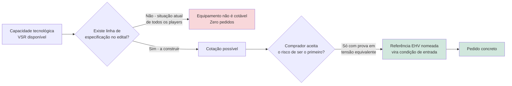
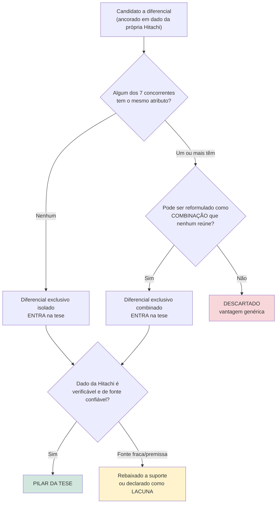
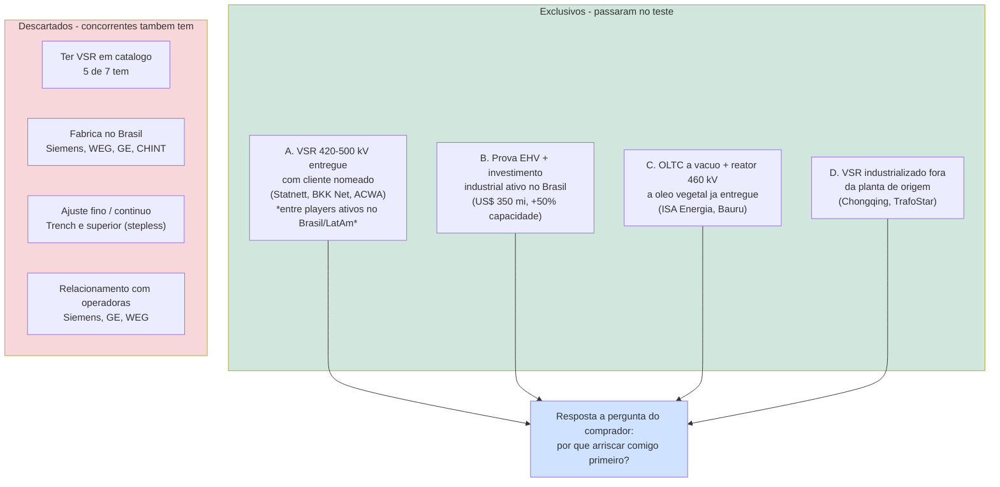
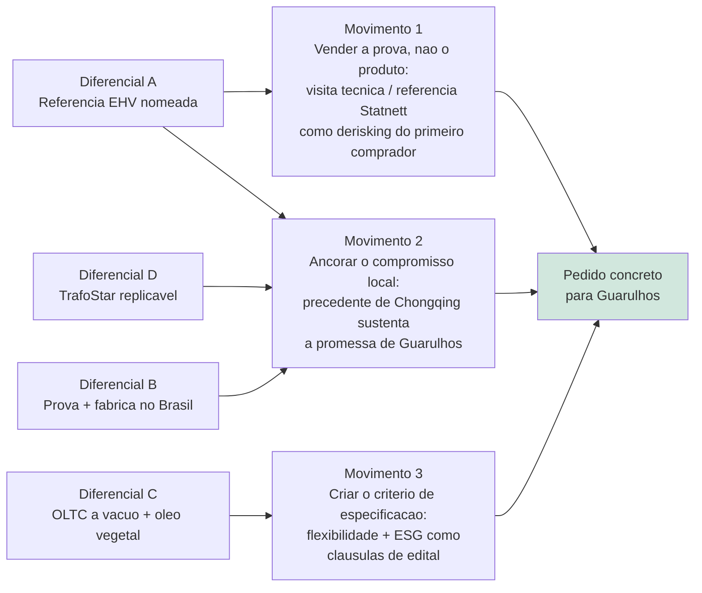

# Item 3 — Análise de Concorrentes: onde o VSR da Hitachi Energy é, de fato, insubstituível

> **Base factual**: `item3-consolidado.md` (7 pesquisas individuais + mapeamento
> inicial + pesquisa do produto próprio). Nenhuma premissa de mercado foi
> criada aqui. Toda afirmação de vantagem está ancorada em um dado sobre a
> **própria** Hitachi Energy, não em inferência por ausência de dado do
> concorrente. Data de acesso das fontes: **2026-09-08**.

---

## 1. Sumário executivo — a tese em uma frase

> **Não há disputa de mercado a vencer: há uma categoria de compra a criar.**
> Nenhum dos sete fornecedores pesquisados — nem a própria Hitachi Energy —
> tem uma referência de reator shunt variável instalada no Brasil ou na
> América Latina, e nenhum edital de transmissão analisado especifica o
> equipamento. Nesse vácuo, **quem vence não é quem tem o melhor catálogo, e
> sim quem consegue provar o equipamento em extra-alta tensão diante de um
> operador identificável.** É exatamente aí que a Hitachi Energy está sozinha
> **entre os fornecedores com presença comercial ativa no Brasil/América
> Latina**: é a única desse grupo com VSR de 420–500 kV entregue, operando e
> com cliente nomeado — e a única que soma essa prova a um ciclo de
> investimento industrial ativo em transformadores de potência no Brasil.

> ⚠️ **Qualificador de escopo (obrigatório em qualquer slide que reproduza a
> frase acima)**: a exclusividade afirmada é **comercial-geográfica, não
> tecnológica global**. Dois fabricantes têm VSR/CSR real em extra-alta tensão
> e ficam fora do teste **apenas** por não terem presença comercial comprovada
> na região: **Hyosung Heavy Industries** (VSR entregue a KEPCO/Coreia e
> ElectraNet/Austrália) e **BHEL** (CSR de 765 kV nacionalizado na Índia) —
> ver seção 10. Extraída sem esse qualificador, a afirmação vira uma alegação
> de exclusividade mundial que os dados **não** sustentam.

**Consequência estratégica**: o ativo comercial mais valioso da Hitachi neste
case não é o produto — é a **evidência**. Ela é a única moeda aceita por um
comprador conservador que ainda não tem uma linha de especificação para o
equipamento, e é a alavanca que converte capacidade fabril em pedido.

---

## 2. O ponto de partida: um mercado vazio, não disputado

**O gargalo entre capacidade tecnológica e pedido concreto não é técnico nem
industrial — é probatório e normativo: nenhum fornecedor, Hitachi inclusive,
tem referência de VSR instalada no Brasil/LatAm, homologação ONS/ANEEL ou
edital que especifique o equipamento, então a disputa não é por market share,
é pela primeira instalação.**

Três constatações do dossiê consolidado definem o tabuleiro e precisam ser
aceitas antes de qualquer argumento competitivo:

| Constatação | Evidência | Implicação |
|---|---|---|
| Nenhuma referência de VSR no Brasil/LatAm — de ninguém | Nem Hitachi, nem Siemens, nem CHINT, nem Trench, nem Hyundai, nem BTW têm caso confirmado na região | A disputa não é por market share; é por **primeira instalação** |
| Nenhuma homologação ONS/ANEEL de VSR — de ninguém | Só existe um sandbox regulatório genérico da ANEEL para serviços ancilares de controle de tensão | Não há barreira de certificação a superar, mas também não há trilho pronto: a especificação precisa ser **construída** |
| Nenhum leilão 2024–2025 especificou reator variável | Editais ANEEL revisados especificam reatores de barra **fixos** (análise por amostragem) | Sem influência sobre a especificação, o VSR **não tem onde ser cotado** |

**Leitura**: o gargalo entre capacidade e pedido não é técnico nem industrial —
é **probatório e normativo**. Por isso o teste de exclusividade abaixo prioriza
atributos que respondem à pergunta "por que arriscar comigo primeiro?".

---

## 3. Metodologia — o teste de exclusividade aplicado

**Só entra na tese o atributo que nenhum dos 7 concorrentes com presença
comercial ativa no Brasil/América Latina reúne — isolado ou em combinação; o
resto, por mais real que seja, é vantagem genérica e foi descartado (seção
5).**

Cada candidato a diferencial foi confrontado, na comparação de via dupla do
dossiê, contra **os 7 concorrentes pesquisados em profundidade**: Siemens
Energy, HD Hyundai Electric, CHINT, Trench Group, BTW Electric (VSR
confirmado) + WEG e GE Vernova (sem VSR confirmado).

**Universo do teste (declarado explicitamente)**: esses 7 são os fornecedores
que passaram no duplo critério do `contexto-caso.md` — mesma lacuna funcional
(regulação contínua de reativos, excluindo STATCOM/SVC de grande porte) **e**
presença comercial comprovada no Brasil/América Latina. Toda afirmação de
exclusividade nesta tese vale **dentro desse universo**; os fabricantes
filtrados pelo critério geográfico estão listados e justificados na seção 10 e
são reconhecidos como risco de entrada.

---

## 4. Matriz de exclusividade — o cruzamento completo

**A matriz confirma, atributo por atributo, os quatro diferenciais da seção
6: a Hitachi tem "Sim" isolado ou combinado exatamente nos pontos que os
sustentam (VSR em EHV com cliente nomeado, investimento industrial ativo no
Brasil, industrialização fora da planta de origem, reator EHV a óleo
vegetal) — e compartilha com todos os concorrentes as duas lacunas
estruturais do mercado: nenhuma referência de VSR no Brasil/LatAm e nenhuma
homologação ONS/ANEEL.**

Legenda: **Sim** = atributo confirmado nas fontes; **Não** = ausência
confirmada ou produto inexistente; **N.C.** = não confirmado / dado
indisponível nas fontes pesquisadas.

| Atributo | Hitachi | Siemens | Hyundai | CHINT | Trench | BTW | WEG | GE Vernova |
|---|---|---|---|---|---|---|---|---|
| Produto VSR/CSR confirmado | Sim | Sim | Sim | Sim | Sim | Declarado (sem ficha técnica) | Não | Não |
| Caso de VSR real com **cliente nomeado** | **Sim** (Statnett, BKK Net, ACWA Power) | Sim (Amprion) | Não (nenhum caso no mundo) | Não (país e cliente não identificados) | Não | Não (tipo do reator incerto) | Não | Não |
| Caso de VSR real em **≥420 kV** | **Sim** (420 kV Noruega; 500 kV Uzbequistão) | Não (caso real = 220 kV) | Não (765 kV só em catálogo) | Não (400 kV, e sem cliente) | Não (132 kV confirmado) | N.C. | Não | Não |
| Investimento industrial ativo em transformadores/reatores de potência no Brasil | **Sim** (US$ 200 mi 2024 + US$ 150 mi 2026; +50% capacidade) | Sim (Jundiaí desde 2007) | Não | Parcial (fábrica de medidores, Manaus) | N.C. (conflito de CNPJ) | Não | Sim (4 fábricas T&D) | Sim (Itajubá, Taubaté) |
| VSR industrializado fora da planta de origem | **Sim** (Chongqing, 2024, TrafoStar) | N.C. (só Nuremberg) | N.C. | N.C. | N.C. | N.C. | N/A | N/A |
| Reator EHV a **éster/óleo vegetal** entregue no Brasil | **Sim** (ISA Energia, 460 kV, Bauru/SP, 2026) | N.C. | N.C. | N.C. | N.C. | N.C. | N.C. | N.C. |
| OLTC a vácuo declarado na geração atual | **Sim** | N.C. | N.C. | N.C. | N/A (núcleo móvel) | N.C. | N/A | N/A |
| Regulação verdadeiramente contínua (stepless) | Não (degraus de OLTC) | Não (OLTC) | Não (tap changer) | N.C. | **Sim** (núcleo móvel, 20–100%) | N.C. | N/A | N/A |
| Referência de VSR no Brasil/LatAm | **Não** | Não | Não | Não | Não | N.C. | Não | Não |
| Homologação ONS/ANEEL de VSR | **Não** | Não | Não | Não | Não | Não | Não | Não |

> **Nota metodológica sobre a linha "reator EHV a éster/óleo vegetal"**:
> nenhuma das pesquisas individuais buscou especificamente por fluido isolante
> alternativo nos portfólios de HD Hyundai, CHINT, Trench e BTW. Marcar "Não"
> nessas células seria inferir ausência a partir de ausência de dado — o
> oposto do princípio declarado nesta análise. Por isso todas as células de
> concorrentes nessa linha estão como **N.C.**, e o Diferencial C é
> explicitamente tratado como **assimetria de evidência** (a Hitachi tem um
> fato positivo documentado; os concorrentes têm um dado não pesquisado), não
> como prova de incapacidade alheia.

### Tensão de catálogo declarado vs. lastro de evidência

```mermaid
xychart-beta
    title "VSR em kV - catalogo declarado x lastro de evidencia documentada"
    x-axis ["Hitachi", "Hyundai", "Siemens", "CHINT", "Trench"]
    y-axis "kV" 0 --> 800
    bar [500, 765, 800, 400, 345]
    bar [500, 0, 220, 400, 132]
```

*Barra 1 = tensão máxima **declarada em catálogo**; Barra 2 = tensão máxima com
**lastro de evidência documentada**.*

**Aviso de padrão de evidência (as barras 2 não são todas do mesmo tipo)**:

| Empresa | O que a barra 2 representa | Padrão de evidência |
|---|---|---|
| Hitachi Energy (500 kV) | Unidade entregue ao parque Dzhankeldy, cliente **ACWA Power**, Uzbequistão, 2024 (e 420 kV a Statnett/BKK Net, Noruega) | Projeto com **cliente nomeado** |
| Siemens Energy (220 kV) | VSR de 220 kV/300 MVAr para a operadora **Amprion**, datasheet 2017 | Projeto com **cliente nomeado** |
| CHINT (400 kV) | Projeto de 400 kV/200 Mvar na "Europa Central", 2024 | Projeto divulgado, **sem país nem cliente identificados** |
| Trench Group (132 kV) | **Maior variante de catálogo confirmada** (ficha DirectIndustry) | **Especificação de catálogo — não há projeto ou cliente nomeado** |
| HD Hyundai (0) | Nenhum caso documentado em nenhum lugar do mundo nas fontes | Sem lastro |

**A distância entre as duas barras é a medida do risco que o comprador
assume.** Na Hitachi ela é zero (500 kV declarado = 500 kV entregue, com
cliente nomeado). Na HD Hyundai, o catálogo de 765 kV não tem lastro nenhum.
Na Siemens, o lastro real (220 kV) está a 27% do catálogo. Na CHINT, o caso de
400 kV não identifica nem país nem cliente — não é auditável por um operador
brasileiro que queira ligar para a referência. E na **Trench**, o valor de
132 kV não é sequer um projeto: é a maior variante que a ficha de catálogo
confirma, com a variante de 345 kV sem MVAr divulgado (PDF técnico bloqueado).

**A BTW Electric foi deliberadamente removida deste gráfico.** A empresa não
publica ficha técnica de VSR, portanto **não tem tensão de catálogo declarada**
a plotar; e os 500 kV frequentemente associados a ela vêm do **projeto do
Uruguai (29 reatores, 2021), cujo tipo — fixo ou variável — nenhuma fonte
confirma**. Plotá-la como "500 kV de catálogo" atribuiria à empresa uma
especificação que ela não divulga e uma capacidade que as fontes não
sustentam.

---

## 5. Bateria de testes — o que foi descartado e por quê

**Onze candidatos a diferencial não resistiram ao teste isolado — de "ter VSR
em portfólio" a "menor MTBF da indústria" — porque pelo menos um concorrente
também os tem, ou porque a fonte é fraca demais para sustentar a alegação;
dois deles só sobrevivem reformulados dentro de uma combinação (Diferencial
B, seção 6).**

Rigor exige mostrar o que **não** sobreviveu. Estes candidatos foram
levantados e **rejeitados** como diferenciais isolados:

| Candidato a diferencial | Concorrentes que também o têm | Veredito |
|---|---|---|
| "Ter um VSR em portfólio" | Siemens, HD Hyundai, CHINT, Trench, BTW (5 de 7) | **Descartado** — atributo de entrada, não diferencial |
| "Presença industrial no Brasil" | Siemens (Jundiaí), WEG (4 fábricas), GE Vernova (Itajubá/Taubaté), CHINT (Manaus) | **Descartado isolado** → reaproveitado na Combinação B |
| "Marca global tier-1 / escala mundial" | Siemens Energy, GE Vernova, HD Hyundai | **Descartado** — não discrimina |
| "Ajuste fino da tensão / flexibilidade operacional" | Trench faz regulação **stepless** por núcleo móvel — tecnicamente mais contínua que OLTC | **Descartado** — a Hitachi não tem superioridade aqui; reformulado por escala (Diferencial A) |
| "Portfólio completo, incluindo STATCOM/SVC como alternativa" | Siemens, GE Vernova e WEG também oferecem compensação dinâmica de custo mais alto | **Descartado isolado** → reaproveitado na Combinação B |
| "Relacionamento com operadoras brasileiras" | Siemens (Eletrobras/Furnas, R$ 1 bi + R$ 300 mi), GE Vernova (8 compensadores síncronos em 4 subestações), WEG (Guaporé Sul/BTG, Leilão 04/2025) | **Descartado** — a Hitachi não é a mais forte nesse eixo |
| "Homologação/certificação ONS-ANEEL de VSR" | Ninguém tem — nem a Hitachi | **Não é diferencial** — é vácuo de categoria; tratado como lacuna na **seção 8** e convertido em alavanca comercial no **Movimento 3 da seção 9** |
| "Vantagem da ToT Ludvika → Guarulhos" | — | **Rebaixado a lacuna**: não há confirmação pública de ToT **de VSR**; é premissa do case, não fato externo (ver seção 8) |
| "Menor MTBF da indústria" | — | **Descartado**: material de marketing próprio, sem benchmark independente |
| "Liderança de mercado com 16% de share" | — | **Rebaixado a suporte**: fonte comercial de terceiro (Global Market Insights), base majoritariamente de reatores **fixos**, não auditável |
| "Referência de VSR na América Latina" | Ninguém tem | **Lacuna compartilhada** — não pode ser reivindicada por nenhum lado |

---

## 6. Os quatro diferenciais que passaram no teste

**Quatro diferenciais sobrevivem ao teste — referência de VSR em extra-alta
tensão com cliente nomeado; essa mesma prova somada a investimento industrial
ativo no Brasil; OLTC a vácuo aliado a um reator de EHV a óleo vegetal já
entregue no país; e evidência de industrializar VSR fora da planta de origem
— e todos respondem à mesma pergunta do comprador conservador: por que
arriscar comigo primeiro?**

### Diferencial A — Entre os fornecedores com presença comercial ativa no Brasil/América Latina, o único com VSR de extra-alta tensão entregue e com operador identificável
**(exclusivo isolado, dentro do universo geográfico do teste)**

**Ancoragem no dado da própria Hitachi**: 10 unidades de VSR de **420 kV**
entregues a **Statnett** e **BKK Net** na Noruega entre 2012 e 2016 (operando
há mais de uma década); e o maior VSR já fabricado pela empresa, **500 kV**,
entregue em 2024 ao parque eólico **Dzhankeldy (ACWA Power)**, no Uzbequistão.

> **Reconciliação de fonte sobre a potência das unidades norueguesas**: o
> *customer story* oficial da Hitachi Energy ("Ensuring power quality and
> reliability in Norway") registra a faixa **90–200 Mvar**; uma figura técnica
> de terceiro publicada na ResearchGate descreve a mesma aplicação de 420 kV na
> rede norueguesa como **120–200 Mvar** (consta assim no próprio título da
> figura). **Divergência entre fontes não resolvida** — provavelmente reflete
> unidades de lotes diferentes (as duas últimas, de 2015–2016, têm faixa de
> regulação estendida), mas isso é hipótese, não dado. **Tratamento adotado**:
> usar a fonte primária da Hitachi (**90–200 Mvar**) como referência e
> apresentá-la como **faixa aproximada**, nunca como especificação exata; o
> pilar do argumento é a **classe de tensão (420 kV) e o cliente nomeado**, que
> ambas as fontes confirmam sem divergência.

**Exclusividade verificada contra**:
- **Siemens Energy** — tem caso real e nomeado (Amprion, 2017), mas em
  **220 kV**; o catálogo de 800 kV não tem nenhum caso correspondente. Não
  atinge o critério de EHV real.
- **HD Hyundai Electric** — catálogo de 765 kV/250 MVAr, porém **nenhum caso
  nomeado em nenhum lugar do mundo** citado nas fontes.
- **CHINT** — caso único de 400 kV/200 Mvar em "Europa Central", **sem país
  nem cliente identificados** (e o indício de "Sérvia" veio de leitura
  automatizada de imagem, não confirmado). Não é referência auditável.
- **Trench Group** — máximo confirmado de **132 kV / 50 MVAr**, e ainda assim
  por **especificação de catálogo**, não por projeto nomeado; uma ordem de
  grandeza abaixo. A variante de 345 kV não tem MVAr confirmado (PDF técnico
  bloqueado).
- **BTW Electric** — não há uma única referência **confirmada** de VSR em
  lugar nenhum do mundo; no projeto do Uruguai não se sabe se os 29 reatores
  eram fixos ou variáveis.
- **WEG** e **GE Vernova** — não têm produto VSR confirmado por fonte
  primária.

**Limite explícito da exclusividade (não omitir em apresentação)**: fora do
universo geográfico do teste, **Hyosung Heavy Industries** (VSR entregue a
KEPCO e ElectraNet) e **BHEL** (CSR de 765 kV na Índia) **também têm** o
atributo tecnológico de reator variável/controlável em extra-alta tensão. Eles
não invalidam o Diferencial A porque não têm presença comercial, projeto ou
exportação comprovada para Brasil/América Latina (seção 10) — mas isso torna
a exclusividade **de janela**, não estrutural (ver "vantagem temporal" na
seção 10).

**Por que isso gera pedido**: um operador brasileiro que nunca comprou VSR não
compra especificação — compra precedente. Entre os fornecedores efetivamente
disponíveis para ele hoje, a Hitachi é a única que pode apresentar, na mesma
classe de tensão do SIN, um ativo operando há mais de dez anos sob um operador
nacional de transmissão (Statnett) que o comprador pode contatar diretamente.

---

### Diferencial B — Única a reunir prova de VSR em EHV **e** ciclo industrial ativo de transformadores de potência no Brasil
**(exclusivo por combinação — cada atributo isolado existe em concorrentes diferentes)**

**Ancoragem no dado da própria Hitachi**: (i) as referências de 420–500 kV do
Diferencial A; (ii) **US$ 200 milhões** anunciados em set/2024 e **US$ 150
milhões adicionais** em mar/2026 para expandir a manufatura de
transformadores de potência em **Guarulhos e Pindamonhangaba** (+50% de
capacidade, conclusão entre 2025 e 2027), com objetivo declarado de atender o
Brasil e exportar; (iii) projeto real e recente no país — reator de **460 kV
para a ISA Energia Brasil**, em Bauru/SP (2026).

**Exclusividade verificada contra**:
- **Siemens Energy** — tem o eixo industrial (Jundiaí desde 2007, descrita
  como a maior fábrica de transformadores da América do Sul, mais madura que
  a expansão em curso da Hitachi), mas **falha no eixo probatório** (caso real
  de VSR limitado a 220 kV). Além disso, **não há fonte que confirme se a
  linha VSR vendida no Brasil é fabricada em Jundiaí ou importada da
  Alemanha**.
- **WEG** e **GE Vernova** — têm o eixo industrial mais forte da lista
  (WEG: 4 fábricas T&D, maior fabricante de equipamentos elétricos da região;
  GE: Itajubá e Taubaté), mas **nenhum produto VSR confirmado**. Suas
  respostas ao mesmo problema — compensador síncrono rotativo (WEG, 165 MVAr,
  Jauru–Vilhena, 2026; GE, 8 unidades de 300 MVAr desde os anos 1980) — estão
  em categoria de custo estruturalmente superior.
- **CHINT** — tem presença comercial mais antiga (Brasil desde 1998) e canal
  dedicado à linha de reatores, mas a fábrica de Manaus (2025) é de
  **medidores, não de reatores**, e o eixo probatório falha (caso sem cliente).
- **Trench Group** — entidade legal em Contagem/MG desde 1999, porém **sem
  confirmação de que a planta brasileira fabrique ou comercialize VSR**, e com
  conflito de dado cadastral não resolvido (base de CNPJ indica "baixada"
  desde 2009).
- **HD Hyundai Electric** e **BTW Electric** — falham nos dois eixos: nenhuma
  filial, escritório, representante ou projeto nomeado na América Latina
  (Hyundai) e presença regional restrita a um único projeto no Uruguai, de
  tipo de reator não confirmado (BTW).

**Por que isso gera pedido**: prazo e custo logístico só viram argumento
comercial se o comprador acreditar que o equipamento **funciona**. Siemens,
WEG e GE conseguem falar de fábrica local; nenhum deles consegue, ao mesmo
tempo, mostrar VSR de 420–500 kV rodando. A Hitachi é a única que fecha as
duas metades da frase.

---

### Diferencial C — Única com OLTC a vácuo aplicável a fluido isolante alternativo **e** reator de EHV a óleo vegetal já entregue no Brasil
**(exclusivo por combinação — com ressalva de assimetria de evidência)**

**Ancoragem no dado da própria Hitachi**: a geração mais recente do VSR usa
**comutadores de tapes a vácuo** — menor manutenção e **compatíveis com
ésteres naturais**; e a Hitachi entregou à **ISA Energia Brasil** o **primeiro
reator de 460 kV a óleo vegetal da América Latina** (Bauru/SP, mai–ago/2026,
4 unidades de 66,67 MVAr, R$ 18 milhões).

**Exclusividade verificada contra**: **Siemens, HD Hyundai, CHINT, Trench,
BTW, WEG e GE Vernova** — em nenhuma das sete pesquisas individuais apareceu
referência de reator de extra-alta tensão com fluido isolante à base de éster
vegetal, nem declaração de OLTC a vácuo na linha de reatores.

*Ressalva de rigor (dupla)*:
1. **Assimetria de evidência**, não prova de incapacidade: o fluido isolante
   alternativo **não foi objeto de busca específica** nas pesquisas de HD
   Hyundai, CHINT, Trench e BTW — daí o "N.C." dessas células na matriz da
   seção 4. O que sustenta este diferencial é o **fato positivo e datado do
   lado da Hitachi** (o press release do projeto ISA/Bauru), não a ausência de
   dado do outro lado.
2. O único ponto adjacente do lado da concorrência — notícia sobre a Siemens
   iniciar a fabricação de transformadores "sem óleo" no Brasil — veio de uma
   fonte cujo acesso **falhou (erro 403)** e trata de tecnologia seca,
   categoria distinta de éster líquido; por isso não é usada para afirmar nem
   para negar nada. **Item a monitorar.**

**Ressalva honesta e obrigatória**: o reator de Bauru é **fixo, não um VSR**.
O que esse dado prova não é referência de VSR no Brasil — é que a Hitachi já
qualificou, no Brasil e com um operador brasileiro, a combinação
"extra-alta tensão + fluido sustentável", que é exatamente a plataforma sobre
a qual o VSR a vácuo assenta. É uma **ponte de credibilidade**, e deve ser
vendida como tal, jamais como referência de VSR.

**Por que isso gera pedido**: dá ao comprador uma segunda razão para
especificar — critério ESG e de risco ambiental de subestação — que nenhum
concorrente mapeado documenta, e ancora essa razão em uma entrega já feita
para uma transmissora brasileira.

---

### Diferencial D — Única com evidência documentada de industrializar VSR fora da planta de origem
**(exclusivo isolado — com ressalva de assimetria de evidência)**

**Ancoragem no dado da própria Hitachi**: o VSR de 500 kV do Uzbequistão foi
fabricado em **Chongqing (China)**, e não em Ludvika, usando a plataforma
global **TrafoStar**, que a empresa declara replicável "em qualquer fábrica de
transformadores de potência ao redor do mundo".

**Exclusividade verificada contra**: **Siemens** (único caso documentado
fabricado em Nuremberg; sem evidência de produção de VSR em outra planta),
**HD Hyundai, CHINT, Trench e BTW** (nenhum dado de multi-planta para VSR);
**WEG e GE Vernova** (sem produto VSR).

**Ressalva de rigor**: trata-se de **assimetria de evidência**, não de prova de
incapacidade dos concorrentes — nenhum deles publicou dado que negue essa
capacidade. O valor do dado é interno e específico: **é o único fato público
que sustenta a viabilidade da tese de nacionalização em Guarulhos**, já que a
ToT de VSR em si não está confirmada externamente (seção 8). Some-se a isso
que a capacidade de Ludvika está comprometida por contrato recorde com a
Svenska kraftnät até 2027–2032 — a descentralização não é preferência, é
necessidade de capacidade.

---

### Síntese visual dos diferenciais aprovados

---

## 7. Onde a Hitachi **não** pode reivindicar vantagem — e o que fazer

**Em sete frentes — fábrica local, relacionamento comercial, regulação
verdadeiramente contínua, escala industrial nacional, suporte reativo já
operando no Brasil, canal comercial dedicado e referência regional de
reatores de 500 kV — outro concorrente está hoje à frente da Hitachi; a
resposta em cada caso é deslocar a disputa para o terreno da referência em
EHV (Diferencial A), não tentar equiparar a frente em que já perde.**

Rigor competitivo exige nomear as frentes em que o concorrente está à frente.
Ignorá-las é o caminho mais rápido para perder a primeira licitação.

| Frente | Quem está à frente | Fato | Contramedida ancorada em dado próprio |
|---|---|---|---|
| Maturidade da fábrica local | **Siemens Energy** | Jundiaí desde 2007, 190 mil m², 1.400 funcionários, maior fábrica de transformadores da América do Sul; expansão da Hitachi só conclui entre 2025 e 2027 | Não competir por metros quadrados: competir pela referência EHV (Diferencial A), que Jundiaí não tem |
| Relacionamento com o comprador | **Siemens Energy** | R$ 1 bi (2023) e R$ 300 mi (2024) com Eletrobras/Furnas — em FSC, não VSR | Usar os **70 anos de operação no Brasil** (confirmados no press release institucional de 05/09/2024) e o contrato ISA Energia de 2026 como porta de entrada técnica, não comercial ¹ |
| Regulação verdadeiramente contínua | **Trench Group** | Núcleo móvel "stepless", 20–100% da potência nominal, sem degraus | Reconhecer a superioridade conceitual e deslocar o debate para a faixa em que a Trench não tem caso: 132 kV (de catálogo) vs. 420–500 kV (com cliente nomeado) |
| Presença industrial nacional em escala | **WEG** | 4 fábricas T&D, 100% produção nacional para reator fixo, classe 550 kV | Não disputar reator fixo; disputar a lacuna funcional que a WEG não cobre (não tem VSR confirmado) |
| Suporte reativo dinâmico já operando no Brasil | **GE Vernova** | Compensadores síncronos desde os anos 1980; 8 unidades de 300 MVAr em 4 subestações | Posicionar o VSR pela relação custo-benefício: categoria intermediária que a GE não oferece |
| Canal comercial dedicado a reatores no Brasil | **CHINT** | Telefone e e-mail próprios para a linha de reatores no site brasileiro, presença desde 1998 | Vantagem replicável em semanas; não é barreira estrutural |
| Referência regional de reatores de 500 kV | **BTW Electric** | 29 reatores no projeto de 500 kV do Uruguai (2021) | Tipo (fixo vs. variável) não confirmado — explorar a diferença apenas se a variabilidade for verificada |

> ¹ **Correção de rastreabilidade**: versões anteriores desta tese citavam
> **Itaipu** e **Rio Madeira** como projetos do histórico de 70 anos da Hitachi
> no Brasil. A menção nominal a esses dois projetos aparece na pesquisa
> interna (`item3-hitachi-vsr.md`), mas **não há, no registro de fontes desta
> análise, uma nota de sustentação confirmando que o press release de 70 anos
> os cite nominalmente**. A referência específica foi, portanto, **removida do
> argumento** e classificada como **não confirmada** (ver seção 11, alerta 9).
> O que permanece afirmável com lastro é: **70 anos de operação no Brasil** e o
> **projeto ISA Energia Brasil / Bauru-SP (2026)**. Se a área técnica da
> Hitachi confirmar internamente o fornecimento de HVDC para Itaipu e Rio
> Madeira, o argumento pode ser reforçado — até lá, não deve ser usado.

---

## 8. Lacunas de dados que impedem afirmações — declaradas, não presumidas

**Nove lacunas de dado — da confirmação pública da ToT Ludvika→Guarulhos até
a potência exata do VSR norueguês — não têm lastro suficiente para virar
afirmação numa apresentação; a maioria é compartilhada por todos os
concorrentes, não uma fraqueza exclusiva da Hitachi, mas duas delas (itens 8
e 9) são divergências entre as próprias fontes usadas nesta tese.**

Estas são frentes em que **os dados consolidados não sustentam** uma vantagem
da Hitachi. Nenhuma delas deve entrar na apresentação como afirmação.

1. **ToT Ludvika → Guarulhos para VSR: não confirmada publicamente.** Os dois
   press releases de investimento (set/2024 e mar/2026) falam de
   transformadores de potência em geral, **sem mencionar VSR nominalmente**. A
   ToT é premissa do case, não fato anunciado. *Ação*: validar internamente
   antes da apresentação; até lá, sustentar a viabilidade pelo precedente de
   Chongqing/TrafoStar (Diferencial D).
2. **Nenhuma referência de VSR da Hitachi no Brasil ou na América Latina.**
   Lacuna real — porém **compartilhada por todos os sete concorrentes**. Não é
   desvantagem relativa; é a definição do prêmio em jogo.
3. **Nenhuma homologação ONS/ANEEL de VSR.** Não existe para ninguém. *Ação*:
   converter o vácuo em alavanca — o sandbox regulatório da ANEEL para
   serviços ancilares de controle de tensão é o único trilho institucional
   existente e não tem ocupante (desdobrado no Movimento 3 da seção 9).
4. **"Menor MTBF da indústria" não é utilizável.** Alegação de marketing
   próprio, sem benchmark independente localizado.
5. **Share de 16% (Global Market Insights) exige cautela.** Fonte comercial de
   terceiro; a base de "3.000 reatores em 70 países" é majoritariamente de
   reatores **fixos**. Usar apenas como contexto, nunca como prova de
   liderança em VSR.
6. **Sem dado público de preço para nenhum player** — inclusive a Hitachi.
   Toda argumentação de custo-benefício deve ser feita por **categoria
   tecnológica** (VSR vs. compensador síncrono/STATCOM), não por número.
7. **Editais ANEEL lidos por amostragem, não na íntegra.** A conclusão de que
   os leilões especificam reator fixo é **preliminar** e precisa de leitura
   completa dos anexos técnicos antes de virar premissa de plano comercial.
8. **Potência exata das unidades norueguesas: divergência entre fontes.**
   90–200 Mvar (customer story da Hitachi) vs. 120–200 Mvar (figura técnica de
   terceiro na ResearchGate) — usar como **faixa aproximada** e apoiar o
   argumento na classe de tensão e no cliente nomeado (ver Diferencial A).
9. **Projetos históricos específicos no Brasil (Itaipu, Rio Madeira): não
   confirmados** no registro de fontes desta análise — afirmar apenas os "70
   anos no Brasil" e o projeto ISA/Bauru (ver nota da seção 7).

---

## 9. Da capacidade ao pedido — como os diferenciais viram receita

**Os quatro diferenciais só geram pedido através de três movimentos
comerciais concretos: vender a evidência de operação em extra-alta tensão em
vez do catálogo, transformar o precedente de Chongqing em compromisso
verificável para Guarulhos, e propor à ONS/EPE/ANEEL o critério de
especificação antes que qualquer concorrente o faça.**

**Movimento 1 — Vender evidência, não catálogo.** O ativo escasso do mercado é
prova de operação em EHV. Nenhum concorrente com presença comercial ativa na
região pode oferecer visita técnica ou contato de referência a um operador
nacional de transmissão com VSR de 420 kV rodando há mais de dez anos. Esse é
o único argumento que neutraliza o conservadorismo do primeiro comprador.

**Movimento 2 — Transformar a promessa industrial em compromisso verificável.**
Enquanto a ToT não for confirmada publicamente, o precedente de Chongqing é o
fato que sustenta a credibilidade de Guarulhos: a empresa já provou fabricar
VSR fora de Ludvika, e a capacidade de Ludvika está comprometida até
2027–2032.

**Movimento 3 — Escrever o critério antes do edital.** Como nenhum player tem
homologação (lacuna 3 da seção 8) e nenhum edital especifica VSR, quem levar
ao ONS/EPE/ANEEL uma proposta de critério — flexibilidade de reativos + fluido
isolante de baixo risco ambiental — define o campo de jogo. Os Diferenciais A
e C são os únicos que dão a alguém, hoje, autoridade técnica para propor esse
critério. O sandbox regulatório da ANEEL para serviços ancilares de controle
de tensão é o veículo institucional já existente e ainda sem ocupante.

---

## 10. Empresas consideradas e **não aprofundadas** — motivos preservados

**Nove empresas ficaram fora da comparação central por não atenderem ao duplo
critério do case (lacuna funcional + presença comercial na região) — e dois
dos concorrentes tecnologicamente mais maduros do mundo em VSR/CSR (Hyosung,
BHEL) só estão fora por ausência geográfica, o que torna a vantagem da
Hitachi uma janela temporal e reversível, não uma barreira estrutural.**

*(Seção mantida integralmente conforme o dossiê consolidado, por rigor
metodológico: demonstra que a lista de concorrentes foi filtrada por critério
explícito — lacuna funcional de regulação contínua de reativos + presença
comercial comprovada no Brasil/América Latina — e não por conveniência.)*

| Empresa | Motivo específico de não aprofundamento |
|---|---|
| **Toshiba** | Produto de reator shunt confirmado no Brasil (550 kV/70 MVAr) é **fixo** — nenhuma evidência de linha "variable/controllable shunt reactor" no portfólio global. |
| **Prolec (Prolec GE / Xignux)** | Produção ativa de reatores em fábrica própria em Canoas (RS), mas material disponível descreve apenas reatores fixos ("static design"), sem OLTC ou regulação variável. |
| **Efacec** | Presença comercial ativa no Brasil, Argentina e Chile, mas nenhum produto de reator variável/controlável foi localizado no portfólio disponível. |
| **Maschinenfabrik Reinhausen (MR do Brasil)** | Fornece o OLTC — componente usado dentro de um VSR — mas não vende o reator variável completo como produto final; é fornecedora de componente/habilitador de tecnologia (inclusive possivelmente para concorrentes da própria Hitachi), não concorrente direto no contrato de fornecimento de um VSR. |
| **Hyosung Heavy Industries** | Produto "Variable Shunt Reactor" real e robusto, com referências entregues (Coreia/KEPCO, Austrália/ElectraNet), mas **nenhuma evidência de presença comercial, projeto ou exportação para Brasil/América Latina** — referências geográficas da empresa são EUA, Índia, Dinamarca, Kuwait, Coreia e Austrália. |
| **BHEL** | Tecnologia de Controlled Shunt Reactor madura e nacionalizada na Índia (765 kV), mas **nenhuma evidência de exportação ou presença comercial no Brasil/América Latina**. |
| **Zaporizhtransformator (ZTR, Ucrânia)** | Fabricante histórico de CSR com vendas documentadas para a América Latina desde os anos 1980 (Peru, Argentina), mas a fábrica (a maior da Europa no setor) está **fechada para produção civil desde 2022** devido à guerra Rússia-Ucrânia — sem capacidade de produção/exportação ativa comprovada atualmente. Recomendado **monitorar**, não descartar definitivamente. |
| **CG Power / Crompton Greaves** | Dupla lacuna: nenhum produto variável/controlável específico identificado, e nenhuma presença comercial ativa e direta no Brasil/América Latina confirmada (apenas menções genéricas de "market share global"). |
| **Xi'an XD Electric / TBEA (China)** | Citadas repetidamente em relatórios de mercado como fabricantes chinesas de CSR para aplicações UHV, mas presença de mercado é "apenas de categoria de relatório" — nenhuma venda, exportação ou projeto concreto e nomeado no Brasil/América Latina foi encontrado. |

**Mencionadas apenas para contraste (fora do critério funcional, por instrução
explícita do contexto do caso)**: STATCOM/SVC de grande porte resolvem o mesmo
problema de estabilização de tensão/regulação de reativos, com resposta mais
rápida que um VSR, mas com custo de capital e complexidade significativamente
maiores — não contam como concorrente direto, apenas como referência de
contraste de custo-benefício. Confirmado por fonte própria do dossiê para **GE Vernova** (STATCOM citado
explicitamente em `item3-pesquisa-ge-vernova.md`); por tecnologia adjacente de
mesma categoria de custo para **WEG** (compensador síncrono rotativo,
`item3-pesquisa-weg.md`); e para a própria **Hitachi Energy**, cujo portfólio
oficial de FACTS inclui "SVC Light® STATCOM, SVC Light® Enhanced STATCOM,
PCS 6000 STATCOM e STATCOM for distributed power" (fonte:
[hitachienergy.com/products-and-solutions/facts/statcom](https://www.hitachienergy.com/products-and-solutions/facts/statcom),
acessado em 2026-09-09 — dado incorporado após a pesquisa original do dossiê,
por isso não consta em `item3-hitachi-vsr.md`).
A menção à **Siemens Energy** foi removida desta lista: `item3-pesquisa-siemens-energy.md`
não menciona STATCOM/SVC em nenhum ponto — sem fonte própria do dossiê que
sustente essa alegação para a Siemens.

**Relevância estratégica de preservar esta lista**: dois dos players com
tecnologia de VSR mais madura do mundo (**Hyosung** e **BHEL**) estão **fora**
do tabuleiro por ausência de presença regional, e um terceiro (ZTR) está fora
por indisponibilidade de produção. **Esta é a razão exata pela qual toda
afirmação de exclusividade nesta tese carrega o qualificador "entre os
fornecedores com presença comercial ativa no Brasil/América Latina"**: a
janela competitiva brasileira é **artificialmente estreita** — e reversível.
Se a categoria for criada e o mercado se provar, esses entrantes tendem a
aparecer, e a exclusividade do Diferencial A deixa de valer. **A vantagem
temporal é o ativo perecível desta tese.**

---

## 11. Alertas de qualidade de dado herdados (não resolvidos)

**Dez alertas de qualidade de dado permanecem registrados nesta tese — de
atribuições erradas já corrigidas a divergências não resolvidas entre fontes
primárias e secundárias — e nenhum deles reverte os quatro diferenciais da
seção 6, mas todos devem ser verificados antes de qualquer número virar
compromisso público.**

1. **Trench Brasil** — situação cadastral conflitante (base de CNPJ indica
   "baixada" desde 05/10/2009 vs. site institucional e resultados 2025 do
   grupo ativos). Verificar na Receita Federal antes de uso.
2. **WEG** — a especificação "550 kV/70 MVAr" pertence à **Toshiba**, não à
   WEG (erro de atribuição corrigido).
3. **GE Vernova** — a especificação de VSR "160–250 Mvar/420 kV/OLTC"
   atribuída por busca automatizada **não foi localizada em nenhuma fonte
   primária** da empresa; provável conflação com material de terceiros.
4. **CHINT** — "Sérvia" como país do projeto de 400 kV é indício fraco
   (leitura automatizada de imagem), não confirmado por texto oficial.
5. **BTW Electric** — tipo dos 29 reatores do Uruguai (fixo vs. variável) não
   confirmado por nenhuma fonte. Por isso a BTW **não é plotada** no gráfico
   de tensão da seção 4.
6. **Duas alegações descartadas por indício de alucinação, que não devem ser
   usadas em nenhuma peça do case**: (a) "WEG lançou 1ª linha de produção de
   CSR de 550 kV da América Latina em 2023, -65% importação"; (b) "State Grid
   + Furnas implantaram CSR de 1.000 kV na Amazônia, US$ 5,2 bi"
   (tecnicamente inconsistente — não há linha AC de 1.000 kV no Brasil).
7. **Siemens Energy** — não confirmado se a linha VSR vendida no Brasil é
   fabricada em Jundiaí ou importada da Alemanha.
8. **Editais ANEEL** consultados por busca indexada, não lidos na íntegra — a
   conclusão sobre predominância de reator fixo é preliminar.
9. **Faixa de Mvar do VSR norueguês da Hitachi — divergência entre fontes não
   resolvida**: **90–200 Mvar** no customer story oficial da Hitachi Energy vs.
   **120–200 Mvar** no título da figura técnica publicada na ResearchGate para
   a mesma aplicação de 420 kV. A mesma divergência é reproduzida sem ressalva
   em `item3-hitachi-vsr.md` e `item3-consolidado.md`. Tratamento adotado
   nesta tese: faixa **aproximada**, com prioridade para a fonte primária da
   Hitachi; o argumento se apoia na classe de tensão (420 kV) e no cliente
   nomeado, não no valor exato de Mvar.
10. **Itaipu e Rio Madeira no histórico brasileiro da Hitachi — não
    confirmados** no registro de fontes desta análise (o press release de
    70 anos sustenta os "70 anos no Brasil", mas não há nota de sustentação
    para a menção nominal a esses dois projetos). Menção **removida** dos
    argumentos da seção 7; reintroduzir apenas mediante confirmação interna.

---

## Fontes

*Todas acessadas em 2026-09-08. Organizadas por aquilo que sustentam nesta tese.*

### Diferencial A — referências de VSR em extra-alta tensão da Hitachi Energy
- Hitachi Energy — *Ensuring power quality and reliability in Norway* (customer story) — https://www.hitachienergy.com/us/en/news-and-events/customer-stories/ensuring-power-quality-and-reliability-in-norway — **sustenta**: 10 VSR de 420 kV entregues a Statnett e BKK Net (2012–2016), clientes nomeados; faixa de **90–200 Mvar** (fonte primária adotada na reconciliação do Diferencial A).
- ResearchGate — figura técnica *Variable Shunt Reactor 120–200 Mvar, 420 kV as used in the Norwegian transmission grid* — https://www.researchgate.net/figure/ariable-Shunt-Reactor-120-200-Mvar-420-kV-as-used-in-the-Norwegian-transmission-grid_fig1_344565362 — **sustenta**: a classe de 420 kV na rede norueguesa; **e origina a divergência de faixa (120–200 Mvar)** registrada como alerta 9 da seção 11 — fonte de terceiro, não usada como especificação.
- Hitachi Energy — *Scales up VSR to 500 kV*, 08/10/2024 — https://www.hitachienergy.com/us/en/news-and-events/features/2024/10/hitachi-energy-scales-up-variable-shunt-reactor-to-500-kv-for-wind-power-applications — **sustenta**: maior VSR já fabricado (500 kV), cliente ACWA Power, parque Dzhankeldy.
- Windtech International, 2024 — https://www.windtech-international.com/product-news/hitachi-energy-develops-500-kv-variable-shunt-reactor-for-wind-farm-in-uzbekistan — **sustenta**: confirmação independente do caso do Uzbequistão.
- Electrical India Magazine, 2024 — https://www.electricalindia.in/hitachi-energys-variable-shunt-reactor-to-support-uzbekistans-wind-farm/ — **sustenta**: idem (segunda confirmação independente).
- Hitachi Energy — *Variable shunt reactors* (página de produto) — https://www.hitachienergy.com/us/en/products-and-solutions/transformers/reactors-and-inductors/variable-shunt-reactors — **sustenta**: arquitetura OLTC do VSR da Hitachi. *(A alegação de "menor MTBF da indústria" desta mesma página foi descartada — sem benchmark independente.)*

### Diferencial B — investimento industrial no Brasil e presença regional
- Hitachi Energy — *70 anos no Brasil e investimento de US$ 200 milhões*, 05/09/2024 — https://www.hitachienergy.com/br/pt/news-and-events/press-releases/2024/09/hitachi-energy-comemora-70-anos-no-brasil-e-anuncia-investimento-de-mais-de-r-1-2-bilhao-us-200-milhoes — **sustenta**: 70 anos de operação no Brasil e primeiro ciclo de investimento. **Não sustenta** (no registro desta análise) a menção nominal a Itaipu e Rio Madeira — ver alerta 10 da seção 11.
- Hitachi Energy — *Compromisso com a América Latina, US$ 150 milhões adicionais*, 09/03/2026 — https://www.hitachienergy.com/br/pt/news-and-events/press-releases/2026/03/hitachi-energy-reaffirms-commitment-to-latin-america-through-an-additional-150-million-usd-investment-to-expand-power-transformer-manufacturing-capacity — **sustenta**: expansão de Guarulhos/Pindamonhangaba, +50% de capacidade, conclusão 2025–2027; e a **ausência de menção nominal a VSR** (lacuna da seção 8).
- Hitachi Energy — *Record order Svenska kraftnät*, 21/08/2024 — https://www.hitachienergy.com/news-and-events/press-releases/2024/08/hitachi-energy-receives-record-order-from-svenska-kraftn-t-to-strengthen-the-swedish-power-grid — **sustenta**: comprometimento da capacidade de Ludvika até 2027–2032 (racional de descentralização).

### Diferencial C — OLTC a vácuo e reator de EHV a óleo vegetal no Brasil
- Hitachi Energy / ISA Energia Brasil — reator de 460 kV a óleo vegetal, 08/05/2026 — https://www.hitachienergy.com/br/pt/news-and-events/press-releases/2026/05/hitachi-energy-e-isa-energia-brasil-avan-am-na-sustentabilidade-do-sistema-el-trico-com-o-primeiro-reator-de-460-kv-a-leo-vegetal-da-am-rica-latina — **sustenta**: 4 unidades de 66,67 MVAr, Bauru/SP, primeiro reator de 460 kV a óleo vegetal da América Latina (e o fato de ser **fixo**, não VSR).
- Cenário Energia, 08/05/2026 — https://cenarioenergia.com.br/2026/05/08/isa-e-hitachi-energy-instalam-primeiro-reator-de-460-kv-a-oleo-vegetal-da-al/ — **sustenta**: confirmação independente do projeto ISA/Bauru, valor de R$ 18 milhões.
- Hitachi Energy — *Vacuum on-load tap-changers* — https://www.hitachienergy.com/products-and-solutions/insulation-and-components/transformer-insulation-components/tap-changers/vacuum-on-load-tap-changers — **sustenta**: comutadores a vácuo, menor manutenção, compatibilidade com ésteres naturais.

### Diferencial D — industrialização de VSR fora da planta de origem
- Hitachi Energy — *Scales up VSR to 500 kV*, 08/10/2024 (mesma URL acima) — **sustenta**: fabricação em Chongqing (China) e uso da plataforma TrafoStar, declarada replicável em qualquer fábrica de transformadores de potência.

### Contexto de categoria (mercado vazio, regulação, share)
- Global Transmission Report — sandbox da ANEEL para serviços ancilares de controle de tensão — https://globaltransmission.info/brazils-aneel-authorises-ons-to-test-ancillary-voltage-control-services-under-regulatory-sandbox/ — **sustenta**: inexistência de homologação de equipamento; único trilho regulatório disponível (Movimento 3 da seção 9).
- ANEEL — Editais de Leilão 04/2025 (Anexo 2-02) e 01/2024 (Anexo 2-05), antigo.aneel.gov.br — **sustenta**: predominância de reator fixo nos escopos licitados (conclusão **preliminar**, leitura por amostragem).
- ANEEL — portal de resultados de leilões de transmissão — https://portalrelatorios.aneel.gov.br/resultadosLeiloes/leiloesTransmissao — **sustenta**: ausência de VSR como categoria licitada.
- EPE — leilões de transmissão — https://www.epe.gov.br/pt/leiloes-de-energia/leiloes-de-transmissao — **sustenta**: idem.
- Global Market Insights — *Oil Immersed Variable Shunt Reactor Market* — https://www.gminsights.com/industry-analysis/oil-immersed-variable-shunt-reactor-market — **sustenta**: share de 16% e base de 3.000 reatores em 70 países — usado **apenas como suporte contextual**, com ressalva de fonte comercial de terceiro.
- USP — dissertação sobre Reatores Controlados por Saturação (Marco Horita) — https://teses.usp.br/teses/disponiveis/3/3143/tde-23122014-143032/publico/Dissertacao_MarcoHorita.pdf — **sustenta**: contexto técnico de tecnologias de reator controlável.
- IFPE — estudo do reator da SE Morro do Chapéu II — https://repositorio.ifpe.edu.br/xmlui/bitstream/handle/123456789/1149/PROJE%C3%87%C3%95ES%20PARA%20EXPANS%C3%83O%20DA%20TRANSMISS%C3%83O%20E%20IMPACTOS%20DA%20INSER%C3%87%C3%83O%20DE%20UM%20REATOR%20NA%20SUBESTA%C3%87%C3%83O%20MORRO%20DO%20CHAP%C3%89U%20II.pdf — **sustenta**: contexto de inserção de reatores no sistema brasileiro.

### Teste de exclusividade — Siemens Energy
- https://www.siemens-energy.com/global/en/home/products-services/product/reactors.html — **sustenta**: catálogo de VSR 10–300 MVAr / 25–800 kV, regulação até 80%.
- Datasheet Amprion VSR, 2017 — https://assets.new.siemens.com/siemens/assets/api/uuid:5b992c0e14405f78b85c97c447d74f2d717f971e/version:1542790208/2017-01-27-amprion-vsr-final-en.pdf — **sustenta**: único caso real documentado com **cliente nomeado** (220 kV/300 MVAr, Amprion, fabricado em Nuremberg) — base do teste que reprova a Siemens no critério EHV.
- CNN Brasil — contratos de R$ 300 mi com a Eletrobras, 2024 — https://www.cnnbrasil.com.br/economia/negocios/siemens-energy-assina-contratos-de-r-300-mi-com-eletrobras-para-modernizar-transmissao/ — **sustenta**: relacionamento comercial forte da Siemens (frente em que a Hitachi não lidera).
- InfoMoney — contrato de R$ 1 bi com a Eletrobras, 2023 — https://www.infomoney.com.br/negocios/siemens-energy-reformara-linha-da-eletrobras-que-escoa-energia-de-itaipu-por-r-1-bilhao/ — **sustenta**: idem; e que o escopo é FSC, não VSR.
- Econodata — Siemens Energy Brasil Ltda. — https://www.econodata.com.br/consulta-empresa/44013159009687-siemens-energy-brasil-ltda — **sustenta**: operação legal plena no Brasil.
- X / Siemens Brasil — https://x.com/Siemens_Brasil/status/1995553510432120918 — **sustenta**: dados da planta de Jundiaí.
- ABINEE — ficha de associada — https://www.abinee.org.br/associada/cod/606/ — **sustenta**: presença institucional no Brasil.
- DirectIndustry — página de produto de reatores Siemens — https://www.directindustry.com/prod/siemens-energy-power-transmission/product-32878-2230645.html — **sustenta**: especificação de catálogo.
- Canal Energia — transformadores sem óleo no Brasil — https://www.canalenergia.com.br/noticias/53208985/siemens-energy-inicia-fabricacao-de-transformadores-sem-oleo-no-brasil — **fonte com falha de acesso (erro 403)**; citada apenas para registrar a ressalva do Diferencial C, sem sustentar afirmação.

### Teste de exclusividade — HD Hyundai Electric
- https://www.hyundai-electric.com/elect/en/product/product1.jsp — **sustenta**: VSR de catálogo, 40–100% de capacidade, até 765 kV/250 MVAr.
- https://www.hyundai-electric.com/elect/en/company/performance.jsp — **sustenta**: ausência de caso nomeado de VSR.
- https://www.hyundai-electric.com/elect/en/company/heamerica.jsp — **sustenta**: cobertura "Latin America" como escopo genérico, sem projeto na região.
- https://www.hyundai-electric.com/elect/en/company/workplace.jsp — **sustenta**: ausência de unidade na América Latina.
- HD Hyundai Electric — Relatório Integrado 2023 — https://hd.com/common/en/docs/[2023]%20HD%20Hyundai%20Electric%20Integrated%20Report(Issued%20in%202024).pdf — **sustenta**: mercados prioritários e ausência de LatAm.
- Seoul Economic Daily, 07/05/2026 — https://en.sedaily.com/news/2026/05/07/hd-hyundai-electric-wins-127-million-order-at-north — **sustenta**: concentração de carteira em EUA.
- KED Global, 19/01/2025 — https://www.kedglobal.com/energy/newsView/ked202501190002 — **sustenta**: carteira cheia até 2027 (EUA/Reino Unido).
- Korea Herald — https://www.koreaherald.com/article/10732860 — **sustenta**: idem.
- PR Newswire — expansão da subsidiária nos EUA — https://www.prnewswire.com/news-releases/hd-hyundai-electric-expands-us-production-subsidiary-solidifies-leadership-in-north-american-extra-high-voltage-power-transformer-market-302707507.html — **sustenta**: foco geográfico em América do Norte.
- News1 — https://www.news1.kr/industry/general-industry/6159546 ; SME Daily — https://www.smedaily.co.kr/news/articleView.html?idxno=292858 ; LinkedIn — https://gh.linkedin.com/company/hyundaielectric ; Wikipedia — https://en.wikipedia.org/wiki/HD_Hyundai_Electric — **sustentam**: perfil corporativo e ausência de referência à América Latina (busca em português, inglês e coreano).

### Teste de exclusividade — CHINT
- https://www.chintglobal.com/br/pt/products/power-transmission-and-distribution/power-quality-automation/adjustable-reactor.html — **sustenta**: "Reator Ajustável"/VSR no portfólio brasileiro e canal comercial dedicado a reatores.
- https://www.chintglobal.com/br/pt/products/power-transmission-and-distribution/power-quality-automation/shunt-reactor.html — **sustenta**: linha de reatores shunt.
- http://www.chintglobal.com/global/en/about-us/news-center/news/chint-won-the-bid-for-the-vsr-project-in-central-europe.html — **sustenta**: caso de 400 kV/200 Mvar na "Europa Central" **sem país nem cliente identificados** — base do teste que reprova a CHINT no critério de referência auditável.
- https://www.chintglobal.com/global/en/solutions/case-center/400kv-variable-shunt-reactor-vsr-project.html e https://www.chintglobal.com/ae/en/solutions/case-center/400kv-variable-shunt-reactor-vsr-project.html — **sustentam**: replicação do mesmo caso único em múltiplos sites regionais.
- https://www.chintglobal.com/sa/en/products/power-transmission-and-distribution/power-quality-automation/adjustable-reactor.html — **sustenta**: consistência global do produto.
- https://www.chintglobal.com/br/pt/about-us/about-chint/about-chint-brazil.html — **sustenta**: presença no Brasil desde 1998, escritório em São Paulo, centro de distribuição em Extrema/MG.
- https://www.chintglobal.com/br/pt/about-us/factory/hv-factories/power-transformer-factory.html — **sustenta**: parque fabril (fábrica de Manaus dedicada a medidores).
- https://www.chintglobal.com/br/pt/solutions/case-center/anel-cooperation-projects-worldwide-Italy-spain-brazil-chile-colombia-etc.html — **sustenta**: cooperação com a ENEL (reatores não listados explicitamente).
- https://www.chintglobal.com/br/pt/solutions/power-utility/transmission-grid.html — **sustenta**: posicionamento em transmissão no Brasil.

### Teste de exclusividade — Trench Group
- https://www.directindustry.com/prod/trench-group/product-70418-577458.html e https://www.directindustry.com/prod/trench-group/product-70418-577646.html — **sustentam**: VSR "stepless" por núcleo móvel, 20–100%, até 132 kV/50 MVAr confirmado. **Natureza da evidência**: ficha de **catálogo/distribuidor**, não projeto com cliente nomeado — base da nota de padrão de evidência do gráfico da seção 4.
- https://pdf.directindustry.com/pdf/trench-group/variable-shunt-reactors/70418-248453.html — **acesso bloqueado (403)**: motivo pelo qual a variante de 345 kV não tem MVAr confirmado.
- https://trench-group.com/coils-portfolio/ e https://trench-group.com/ — **sustentam**: portfólio de bobinas/reatores e presença em Contagem/MG.
- https://oportunidados.com.br/cnpj/03101850000174/trench-brasil-ltda — **sustenta**: o conflito de dado cadastral (CNPJ "baixado" desde 2009), registrado como alerta não resolvido.
- https://trench-group.com/corporate-news/result-2025-trench-group-continues-on-growth-course-revenue-up-more-than-30-percent/ — **sustenta**: operação ativa do grupo em 2025 (contradizendo a base de CNPJ).
- https://www.rutlandherald.com/news/business/trench-group-opens-first-hsp-manufacturing-facility-in-u-s-to-support-america-s-grid/article_3ade7454-97b6-5d9b-ac0a-25ef5296c097.html — **sustenta**: prioridade de expansão da Trench nos EUA, não na América Latina.

### Teste de exclusividade — BTW Electric
- https://www.btwelectric.com/ ; https://www.btwelectric.com/product/product-23-979.html ; https://www.btwelectric.com/REACTOR.html — **sustentam**: autodeclaração de capacidade de fabricar VSR, **sem ficha técnica pública** — razão pela qual a BTW não tem tensão de catálogo plotável no gráfico da seção 4.
- https://www.btwelectric.com/new/new-0-253.html — **sustenta**: projeto de 500 kV no Uruguai, 29 reatores, **sem especificar fixo ou variável** (valor de projeto, não de catálogo).
- MarketScreener — contrato CMEC/UTE Uruguai — https://www.marketscreener.com/quote/stock/CHINA-MACHINERY-ENGINEERI-12212398/news/China-Machinery-Engineering-CMEC-Signs-Contract-for-Uruguay-s-500kV-Power-Transmission-and-Transfo-35533509/ — **sustenta**: valor do EPC (~US$ 178 mi) e escopo do projeto.
- Seetao — https://www.seetao.com/details/55611.html — **sustenta**: confirmação independente do projeto uruguaio.
- Compras Estatales Uruguai — https://www.comprasestatales.gub.uy/ ; UTE licitações — https://www.ute.com.uy/proveedores/compras/licitaciones — **sustentam**: busca por especificação do tipo de reator, sem resultado conclusivo.

### Teste de exclusividade — WEG (sem VSR confirmado)
- https://www.weg.net/catalog/weg/PT/pt_PT/Geração,-Transmissão-e-Distribuição/Transformadores-e-Reatores-a-Óleo/Reatores-Tipo-Shunt/c/GTD_TO_ROP — **sustenta**: portfólio de reatores shunt **fixos**, sem linha variável.
- https://static.weg.net/medias/h73/h77/ISO-9001-2015-T-D-PORT.pdf — **sustenta**: escopo certificado das fábricas T&D (classe 550 kV, 400–600 MVA).
- https://www.weg.net/institutional/JM/en/news/products-and-solutions/weg-transformers-and-shunt-reactors-are-supplied-for-a-wind-farm-in-northern-colombia — **sustenta**: fornecimento regional de reatores fixos.
- Folha de Vilhena, 13/07/2026 — https://folhadevilhena.com.br/13/07/2026/weg-firma-contrato-para-fornecimento-de-solucao-compensadora-ao-sin/ — **sustenta**: contrato de compensador síncrono de 165 MVAr (Jauru–Vilhena) — categoria de custo superior, não VSR.
- InfoMoney — leilão ANEEL de R$ 5,53 bi — https://www.infomoney.com.br/mercados/aneel-leiloara-r-553-bi-em-linhas-de-transmissao-weg-pode-sair-entre-beneficiadas/ — **sustenta**: posição da WEG nos leilões.
- AECweb — https://www.aecweb.com.br/produto/reatores-de-derivacao-monofasicos-ate-550-kv-70-mvar/18368 — **sustenta**: correção de atribuição (a especificação 550 kV/70 MVAr é da **Toshiba**, não da WEG).
- https://www.gminsights.com/industry-analysis/variable-shunt-reactor-market — **fonte fraca**, citada apenas para registrar a ausência de evidência de produto VSR da WEG.
- https://en.wikipedia.org/wiki/WEG_Industries — **sustenta**: porte industrial da WEG na América Latina.

### Teste de exclusividade — GE Vernova (sem VSR confirmado)
- https://www.gevernova.com/grid-solutions/hvmv_equipment/catalog/reactors.htm — **sustenta**: portfólio de reatores **fixos** (óleo e núcleo de ar), sem linha variável.
- https://www.gevernova.com/electrification/product-overviews/shunt-reactor-controlled-ais-switching-with-ge-vernovas-csd100 — **sustenta**: o CSD100 é chaveamento controlado, não regulação contínua de Mvar.
- https://www.gevernova.com/news/press-releases/ge-vernova-e-o-futuro-da-seguranca-energetica — **sustenta**: 8 compensadores síncronos de 300 MVAr no Brasil, histórico desde os anos 1980.
- https://www.gevernova.com/news/press-releases/ge-vernova-suministrara-equipos-de-condensadores-sincronos-para-mejorar-la — **sustenta**: contrato com a Transelec no Chile (COD 2027).
- https://www.gevernova.com/news/taxonomy/term/2108 e https://library.grid.gevernova.com/product-overviews/ge-vernova-site-video-itajuba — **sustentam**: fábricas de Itajubá/MG e Taubaté/SP.
- CIGRÉ Brasil — workshop "Manobra de Reatores", 07/09/2025 — https://cigre.org.br/blog/2025/09/07/cepel-recebe-o-workshop-manobra-de-reatores/ — **sustenta**: contexto técnico nacional sobre manobra de reatores.
- https://www.gminsights.com/industry-analysis/air-core-variable-shunt-reactor-market — **fonte de relatório**, usada apenas na checagem que **não** confirmou VSR no portfólio da GE.
- Transformer Magazine — VSR com OLTC — https://transformer-magazine.com/transformers-academy/variable-shunt-reactor-oltc-brings-variability-in-reactive-power-compensation/ — **sustenta**: checagem do conflito de atribuição da especificação "160–250 Mvar/420 kV/OLTC" (não é fonte da GE).

### Empresas não aprofundadas (seção 10)
- Toshiba — https://www.aecweb.com.br/produto/reatores-de-derivacao-monofasicos-ate-550-kv-70-mvar/18368 ; https://www.global.toshiba/ww/products-solutions/transmission/products-technical-services/substation-equipment.html — **sustentam**: reator shunt **fixo**, sem linha variável.
- Prolec — https://www.prolec.energy/transformers/specialty-equipment/shunt-reactors/ — **sustenta**: "static design", sem OLTC.
- Efacec — https://en.wikipedia.org/wiki/EFACEC ; https://www.dardus.com.br/empresa/1416396/Efacec-Do-Brasil-Ltda — **sustentam**: presença regional sem produto variável no portfólio.
- Maschinenfabrik Reinhausen — https://br.linkedin.com/company/mr-reinhausen-brasil ; https://www.reinhausen.com/fileadmin/media/mediathek/variable_active_and_reactive_power_control.pdf — **sustentam**: papel de fornecedora do OLTC (componente), não de concorrente no fornecimento do VSR completo.
- Hyosung Heavy Industries — https://www.hyosungheavyindustries.com/en/business/power-products/P010103 — **sustenta**: VSR maduro com referências (KEPCO, ElectraNet), mas sem presença na América Latina — **base do qualificador de escopo** do sumário executivo e do Diferencial A.
- BHEL — https://www.bhel.com/ — **sustenta**: CSR de 765 kV nacionalizado na Índia, sem exportação para a região — **idem, base do qualificador de escopo**.
- Zaporizhtransformator — https://transformer-magazine.com/news/largest-transformer-factory-in-europe-closed-due-to-war/ ; https://www.marketscreener.com/quote/stock/ZAPORIZHTRANSFORMATOR-VAT-9060075/news/Zaporizhtransformator-VAT-ZTR-equipment-will-be-supplied-to-Peru-18556061/ ; https://open4business.com.ua/en/zaporizhtransformator-resumes-supplies-to-argentina/ — **sustentam**: histórico de vendas ao Peru e Argentina e fechamento da fábrica desde 2022.
- CG Power / Crompton Greaves — https://www.power-technology.com/contractors/switchgear/pauwels/ — **sustenta**: ausência de produto variável e de presença direta na região.
- Xi'an XD Electric / TBEA — https://pmarketresearch.com/auto/controllable-shunt-reactor-for-uhv-market/ ; https://www.volza.com/p/shunt-reactor/export/export-from-china/ — **sustentam**: presença "apenas de categoria de relatório", sem projeto nomeado na região.

### Contraste STATCOM/SVC (seção 10) — dado incorporado após a pesquisa original
- Hitachi Energy — página de produto FACTS/STATCOM — https://www.hitachienergy.com/products-and-solutions/facts/statcom, acessado em 2026-09-09 — **sustenta**: portfólio oficial de STATCOM da própria Hitachi Energy (SVC Light® STATCOM, SVC Light® Enhanced STATCOM, PCS 6000 STATCOM, STATCOM for distributed power), usado para corrigir a atribuição da seção 10.

### Documentos internos do case (base de escopo)
- `Nasser/contexto-caso.md` — critérios funcional e geográfico de concorrência; exclusão de STATCOM/SVC como concorrente direto.
- `Nasser/case-original.md` — desafio central (converter capacidade tecnológica em pedidos), contexto da ToT Ludvika→Guarulhos como premissa.
- `Nasser/item3-consolidado.md` — dossiê consolidado das 7 pesquisas individuais + mapeamento + pesquisa do produto próprio; origem de todos os dados acima.
- `Nasser/item3-hitachi-vsr.md` — pesquisa do produto próprio; origem das faixas técnicas do VSR da Hitachi e das lacunas declaradas na seção 8. **Contém as duas divergências sinalizadas nos alertas 9 e 10 da seção 11** (faixa de Mvar da Noruega; menção a Itaipu/Rio Madeira sem nota de sustentação).
