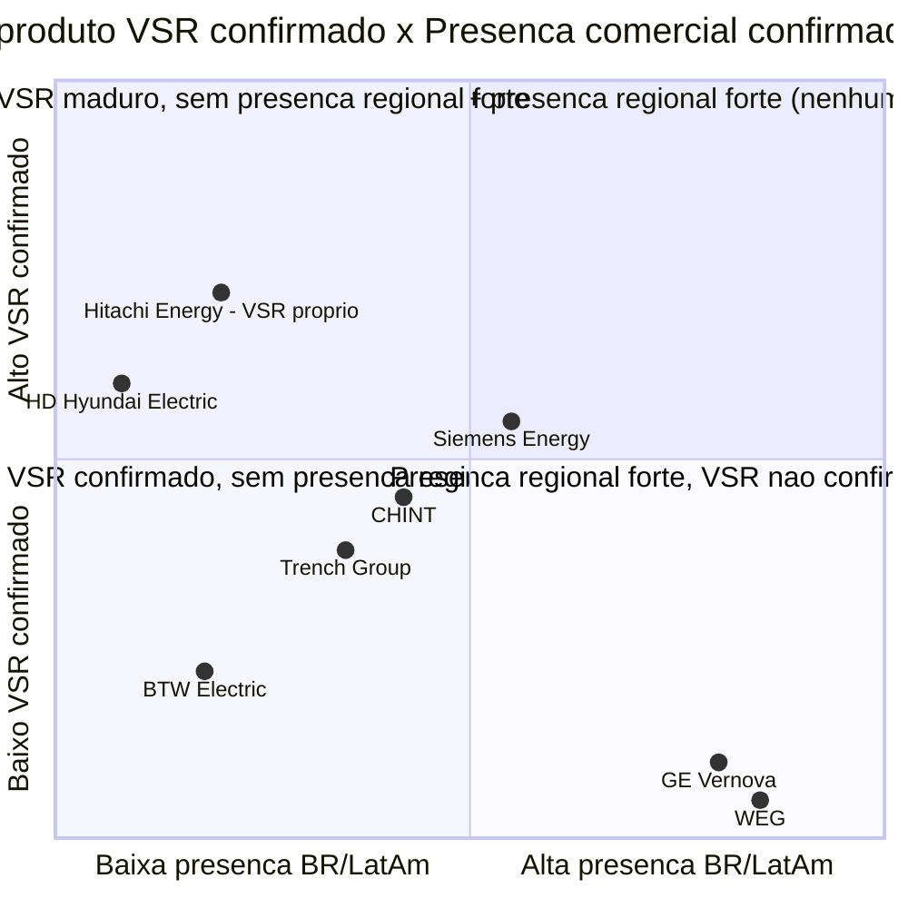

# Item 3 — Consolidação da Análise de Concorrência (VSR / Regulação Contínua de Reativos)

> **Escopo e proveniência dos dados**: este documento consolida, sem adicionar
> dados novos, o conteúdo de 9 arquivos já produzidos na pasta `Nasser/`:
> `item3-empresas-mapeadas.md` (mapeamento inicial de candidatas), os 7
> arquivos `item3-pesquisa-*.md` (pesquisas individuais aprofundadas —
> confirmados via Glob em 2026-09-08, nenhum arquivo adicional pendente:
> `item3-pesquisa-btw-electric.md`, `item3-pesquisa-chint.md`,
> `item3-pesquisa-ge-vernova.md`, `item3-pesquisa-hd-hyundai-electric.md`,
> `item3-pesquisa-siemens-energy.md`, `item3-pesquisa-trench-group.md`,
> `item3-pesquisa-weg.md`) e `item3-hitachi-vsr.md` (pesquisa sobre o próprio
> produto da Hitachi Energy — **não é concorrente**, tratado à parte).
>
> **Não julgo aqui** qual fornecedor é "melhor" no geral nem construo a tese
> final a favor da Hitachi Energy — isso é trabalho do agente analista. Meu
> papel é organizar, cruzar e preservar a rastreabilidade dos dados já
> levantados, constatando fatos nos dois sentidos (onde o concorrente se
> destaca e onde o VSR da Hitachi se destaca no mesmo eixo).
>
> Data de acesso de todas as fontes originais: **2026-09-08**.
>
> ⚠️ **Alertas de dado herdados da pesquisa** (mantidos aqui para não se
> perderem): dois achados de busca automatizada foram investigados e
> **descartados por forte indício de alucinação** — (1) "WEG lançou 1ª linha
> de produção de CSR de 550 kV da América Latina em 2023, -65% importação"
> e (2) "State Grid + Furnas implantaram CSR de 1.000 kV na Amazônia,
> US$ 5,2 bi". Nenhuma das duas deve ser usada em qualquer peça do case.

---

## 1. Referência — VSR Hitachi Energy (não é concorrente, é o produto do próprio case)

Resumo do que a pesquisa `item3-hitachi-vsr.md` levantou sobre o histórico e
posicionamento do VSR da própria Hitachi Energy — usado abaixo como termo de
comparação em cada seção de concorrente, nunca como uma linha a mais na
tabela de concorrência.

- **Referências de instalação confirmadas**: a principal referência mundial
  do produto é a **Noruega** — 10 unidades de VSR de 420 kV / 90–200 Mvar
  entregues a Statnett e BKK Net entre 2012 e 2016 (a Hitachi chama isso de
  "Proven history for future success"). Em outubro/2024, a Hitachi Energy
  produziu seu **maior VSR já fabricado, 500 kV**, para o parque eólico
  Dzhankeldy (ACWA Power) no **Uzbequistão** — fabricado na fábrica de
  **Chongqing (China)**, usando a plataforma global **TrafoStar** (que a
  empresa diz ser replicável "em qualquer fábrica de transformadores de
  potência ao redor do mundo").
- **Lacuna Brasil/América Latina**: **não foi encontrada nenhuma referência
  pública de VSR (equipamento variável) da Hitachi Energy instalado no
  Brasil ou na América Latina.** O caso brasileiro recente mais próximo — o
  reator de 460 kV a óleo vegetal entregue à ISA Energia Brasil em Bauru/SP
  (mai–ago/2026, 4 unidades de 66,67 MVAr, R$ 18 milhões) — é um reator
  **fixo**, não um VSR. O track record de 70 anos da Hitachi no Brasil
  (Itaipu, Rio Madeira) também não inclui reator shunt variável.
- **Certificações/homologação (ONS/ANEEL)**: **nenhum registro público** de
  homologação ou certificação específica de VSR foi encontrado — nem da
  Hitachi, nem de qualquer concorrente. Existe apenas um sandbox regulatório
  genérico da ANEEL para testar serviços ancilares de controle de tensão,
  que não é uma homologação de equipamento.
- **Histórico de licitações**: **nenhuma licitação de transmissão no Brasil
  em 2024–2025 foi encontrada especificando reator shunt variável/
  controlável** no escopo (os leilões ANEEL revisados especificam reatores
  de barra fixos). Não há, portanto, histórico de vitória/derrota em
  licitação de VSR para nenhum player, Hitachi inclusive — consistente com a
  premissa do case de que o mercado de VSR na região ainda não existe como
  categoria de compra formalizada.
- **Vantagem de ToT Ludvika → Guarulhos**: **não há confirmação pública**
  dessa transferência de tecnologia especificamente para VSR nos dois
  press releases mais recentes de investimento da Hitachi no Brasil
  (set/2024, US$ 200 mi; mar/2026, US$ 150 mi adicionais para Guarulhos,
  Pindamonhangaba e Dosquebradas/Colômbia) — a ToT é uma **premissa do case**,
  não um fato anunciado externamente. Fatos adjacentes documentados que
  sustentam a lógica comercial, sem prová-la diretamente: (i) a Hitachi já
  fabricou um VSR fora de Ludvika (Chongqing, 2024) usando a mesma
  plataforma TrafoStar, mostrando viabilidade técnica de descentralizar a
  produção; (ii) a fábrica de Ludvika está com capacidade comprometida por
  contrato recorde com a Svenska kraftnät até 2027–2032; (iii) a expansão
  de Guarulhos/Pindamonhangaba (+50% de capacidade, conclusão 2025–2027) é
  explicitamente para "atender projetos no Brasil e exportar para América
  do Norte, Europa e Oriente Médio" — mas essa tese ainda não menciona VSR
  nominalmente, apenas transformadores de potência em geral.
- **Arquitetura técnica**: o VSR da Hitachi usa **OLTC (comutador de tapes
  sob carga)** — a mesma categoria técnica/de custo que concorrentes que
  também usam tap-changer (Siemens Energy, CHINT, por exemplo). Não é uma
  arquitetura proprietária de categoria de custo superior como STATCOM/SVC.
  A geração mais recente usa comutadores a vácuo (menor manutenção,
  compatível com ésteres naturais). A alegação de "menor MTBF da indústria"
  é de material de marketing próprio, **sem benchmark independente
  encontrado**.
- **Posição de mercado (categoria ampla)**: um relatório comercial (Global
  Market Insights) posiciona a Hitachi como líder com **16% de share em
  2025** no mercado de "oil immersed variable shunt reactor", à frente de
  Siemens Energy, GE Vernova, Toshiba e Hyosung, e credita à empresa **mais
  de 3.000 reatores shunt entregues em 70 países** — mas essa base é
  majoritariamente de **reatores fixos**, sem dado específico de VSR no
  Brasil/LatAm, e deve ser tratada com cautela por ser fonte comercial de
  terceiros, não uma fonte primária ou dado auditável.

---

## 2. Panorama comparativo — concorrentes pesquisados em profundidade

Convenção: "confiança" reflete a classificação original do mapeamento
(`item3-empresas-mapeadas.md`) antes do aprofundamento. WEG e GE Vernova
haviam sido *descartadas* nesse mapeamento inicial, mas ganharam pesquisa
individual aprofundada mesmo assim — mantidas aqui com a ressalva de que,
ao final da pesquisa, **nenhuma das duas teve produto VSR/CSR confirmado**.

| Empresa | Confiança (mapeamento inicial) | Produto VSR/CSR confirmado? | Faixa técnica documentada | Referência concreta de fornecimento (VSR) | Presença comercial confirmada Brasil/LatAm |
|---|---|---|---|---|---|
| Siemens Energy | Alta | **Sim** (catálogo oficial) | 10–300 MVAr / 25–800 kV (catálogo); único caso técnico detalhado real = 220 kV/300 MVAr, Amprion (Alemanha, 2017) | Nenhum caso nomeado de venda/instalação de VSR no Brasil/LatAm | Sim, forte (fábrica Jundiaí desde 2007; contratos Eletrobras/Furnas 2023–2024, mas de FSC, não VSR) |
| HD Hyundai Electric | Média-Alta | **Sim** (catálogo oficial) | 40–100% de capacidade, até 765 kV / 250 MVAr | Nenhum caso nomeado em nenhum lugar do mundo citado nas fontes; carteira 2024–2027 concentrada em EUA/Reino Unido/Arábia Saudita | Não — nenhuma filial, escritório ou projeto nomeado na região; cobertura "remota" via subsidiária dos EUA |
| CHINT | Média | **Sim** (produto "Reator Ajustável"/VSR no site institucional) | Caso concreto único: 400 kV / 200 Mvar, "Europa Central" (2024), país/cliente não identificados | Nenhum caso nomeado no Brasil/LatAm | Sim, forte em outras linhas (Brasil desde 1998, 1ª fábrica na América do Sul em Manaus/2025 — mas para medidores, não reatores) |
| Trench Group | Média | **Sim** (linha "Variable Shunt Reactor", regulação "stepless" via núcleo móvel) | Até 132 kV / 50 MVAr confirmado; variante "até 345 kV" citada mas MVAr não confirmado | Nenhum caso nomeado no Brasil/LatAm | Presença legal desde 1999 (Contagem-MG), mas não confirmado se a planta brasileira fabrica/vende VSR; conflito de dado sobre situação do CNPJ (ver seção 5) |
| BTW Electric | Baixa | **Declarado** (autodeclaração "one of the few..."), sem ficha técnica pública | Não divulgada publicamente | Projeto Uruguai (29 reatores, 500/110/31,5 kV, 2021) — **tipo (fixo vs. variável) não confirmado** | Só Uruguai (tipo de reator incerto); nenhuma evidência no Brasil |
| WEG | — (descartada no mapeamento, pesquisada mesmo assim) | **Não** — nenhuma fonte primária confirma VSR/CSR; alegação anterior de CSR 2023 refutada | N/A para VSR; fixo até classe 550 kV, 400–600 MVA por fábrica | Nenhuma (produto não existe nas fontes encontradas) | Sim, muito forte para reator **fixo** e para compensador síncrono (contrato recente com Guaporé Sul/BTG, Leilão ANEEL 04/2025) — mas essas tecnologias não são VSR |
| GE Vernova | — (descartada no mapeamento, pesquisada mesmo assim) | **Não** — portfólio atual é reator fixo + CSD100 (chaveamento) + compensador síncrono/STATCOM | N/A para VSR | Nenhuma (produto não existe nas fontes encontradas) | Sim, muito forte para compensador síncrono (8 unidades de 300 MVAr no Brasil desde os anos 1980; contrato Transelec no Chile, COD 2027) — mas categoria de custo mais alta, não VSR |

### Diagrama de posicionamento (maturidade de produto VSR x presença comercial confirmada na região)

**Leitura do diagrama (constatação, não julgamento)**: nenhum player —
incluindo a própria Hitachi Energy — ocupa o quadrante superior direito
(VSR maduro + presença regional forte). Isso é consistente com a premissa
central do case de que o mercado de VSR na região ainda precisa ser
"criado", não disputado numa categoria de compra já existente.

### Faixas técnicas documentadas (para contexto de escala)

| Empresa | Tensão máxima documentada | Potência máxima documentada | Mecanismo de regulação |
|---|---|---|---|
| Hitachi Energy (referência) | 500 kV (Uzbequistão, 2024) | 200 Mvar (Noruega, por unidade) | OLTC (vácuo na geração mais recente) |
| Siemens Energy | 800 kV (catálogo) / 220 kV (único caso real documentado) | 300 MVAr (catálogo e caso Amprion) | OLTC, até 80% de variação |
| HD Hyundai Electric | 765 kV (catálogo) | 250 MVAr (catálogo) | Tap changer, 40–100% de capacidade |
| CHINT | 400 kV (caso concreto) | 200 Mvar (caso concreto) | Reator ajustável (mecanismo não detalhado nas fontes) |
| Trench Group | 132 kV confirmado / até 345 kV citado sem MVAr | 50 MVAr confirmado | Núcleo móvel ("plunger core"), regulação "stepless" 20–100% |
| BTW Electric | 500 kV (projeto Uruguai, tipo de reator incerto) | Não divulgada | Não divulgado |
| WEG | 550 kV classe (reator fixo) | 400–600 MVA por fábrica (reator fixo) | Fixo — não aplicável a VSR |
| GE Vernova | Não divulgada para reator fixo; compensador síncrono 300 MVAr por unidade | 300 MVAr (compensador síncrono, Brasil) | Fixo / chaveamento controlado (CSD100) / máquina rotativa (compensador síncrono) |

---

## 3. Comparação por empresa (tecnologia, preço, presença geográfica e via dupla com o VSR da Hitachi Energy)

### 3.1 Siemens Energy
**Tecnologia**: linha oficial "Variable Shunt Reactor" com OLTC, 10–300 MVAr,
25–800 kV, regulação de até 80%. Único caso técnico real e detalhado
encontrado é o VSR de 220 kV/300 MVAr fabricado em Nuremberg (Alemanha)
para a operadora Amprion (datasheet de 2017); nenhuma fonte confirma se a
linha VSR é fabricada localmente em Jundiaí ou importada.
**Posicionamento de preço**: sem dado público de preço ou de posicionamento
premium/commodity específico para reatores/VSR no Brasil — lacuna
explicitamente reportada na pesquisa.
**Presença geográfica**: operação legal plena (Siemens Energy Brasil Ltda.)
e fábrica em Jundiaí/SP desde 2007 (190 mil m², 1.400 funcionários,
descrita como maior fábrica de transformadores da América do Sul).
Contratos recentes de grande porte com Eletrobras/Furnas (R$ 300 mi em
2024; R$ 1 bi em 2023) — mas de **compensação série fixa (FSC)**, não VSR.

**Comparação com o VSR da Hitachi Energy (via dupla)**:
- *Onde a Siemens se destaca*: fábrica local verticalizada e estabelecida
  desde 2007 (mais antiga que a expansão em curso da Hitachi em Guarulhos/
  Pindamonhangaba, ainda em conclusão para 2025–2027); portfólio de catálogo
  numericamente mais amplo (até 800 kV/300 MVAr); relacionamento comercial
  já comprovado e recorrente com grandes operadoras brasileiras
  (Eletrobras/Furnas) em temas de reativos/estabilização de tensão, ainda
  que em outra tecnologia (FSC).
- *Onde o VSR da Hitachi se destaca*: a Hitachi tem **dois** casos reais e
  nomeados de VSR entregue e operando (Noruega, 10 unidades, 2012–2016; e o
  VSR de 500 kV no Uzbequistão, 2024, maior tensão já produzida pela
  empresa nessa categoria), enquanto o único caso técnico real da Siemens
  encontrado (Amprion, Alemanha) é de 2017 e não tem outros casos
  documentados nas fontes pesquisadas — ou seja, a base de referências de
  VSR efetivamente entregue e documentado é mais robusta do lado Hitachi,
  apesar de nenhuma das duas ter referência na América Latina.

### 3.2 HD Hyundai Electric
**Tecnologia**: "Variable Shunt Reactor 40–100% Capacity Range", até
765 kV/250 MVAr — faixa tecnicamente comparável (em catálogo) à do VSR da
Hitachi. Reatores shunt >345 kV são "World Class Product" da empresa desde
2012.
**Posicionamento de preço**: sem nenhum dado público de preço, nem
globalmente nem para a região.
**Presença geográfica**: **nenhuma** filial, escritório, representante ou
projeto nomeado na América Latina foi encontrado (busca em português,
inglês e coreano). A cobertura de "United States, Canada and Latin
America" declarada pela subsidiária HD Hyundai Electric America é
descrição de escopo comercial genérica, sem evidência de venda efetiva na
região. Carteira de pedidos da empresa está concentrada e "cheia até 2027"
em EUA e Reino Unido.

**Comparação com o VSR da Hitachi Energy (via dupla)**:
- *Onde a HD Hyundai se destaca*: faixa de tensão de catálogo mais alta
  (765 kV) que qualquer caso documentado da Hitachi (max. real entregue:
  500 kV, Uzbequistão) — ainda que seja especificação de catálogo, não caso
  de instalação real confirmado.
- *Onde o VSR da Hitachi se destaca*: a Hitachi tem histórico de 70 anos de
  operação no Brasil (incluindo Itaipu e Rio Madeira) e um projeto recente
  e nomeado no país (reator para ISA Energia Brasil, Bauru/SP, 2026, ainda
  que de reator fixo, não VSR) e investimento industrial ativo em Guarulhos/
  Pindamonhangaba — a HD Hyundai não tem nenhum equivalente: nenhuma
  presença física, projeto ou mesmo menção nominal ao Brasil foi encontrada
  em nenhuma fonte pesquisada.

### 3.3 CHINT
**Tecnologia**: "Reator Ajustável"/Variable Shunt Reactor listado no
portfólio de transmissão do site institucional brasileiro. Único caso
concreto de VSR divulgado pela própria empresa (replicado em várias
localidades do site global) é de 400 kV/200 Mvar na "Europa Central"
(07/08/2024), com tempo de resposta <10ms e redução de perdas >15%
declarados — país e cliente não identificados.
**Posicionamento de preço**: nenhum dado direto de preço no Brasil. A
hipótese de preço mais competitivo (comum a fabricantes chineses) é
plausível mas não sustentada por dado concreto nas fontes.
**Presença geográfica**: presença comercial confirmada e antiga no Brasil
(desde 1998), escritório em São Paulo, centro de distribuição em Extrema
(MG), 1ª fábrica no Brasil/América do Sul em Manaus (2025, dedicada a
medidores, não reatores), contato comercial dedicado à linha de reatores/
transmissão, e cooperação multi-país com a ENEL citando Brasil, Chile e
Colômbia (reatores não aparecem explicitamente na lista de categorias
desse case).

**Comparação com o VSR da Hitachi Energy (via dupla)**:
- *Onde a CHINT se destaca*: presença comercial local mais antiga e
  diversificada no Brasil (desde 1998, com fábrica própria já instalada
  desde 2025, ainda que não de reatores) e um canal comercial já dedicado e
  publicamente divulgado especificamente para a linha de reatores no site
  brasileiro (telefone e e-mail próprios).
- *Onde o VSR da Hitachi se destaca*: o caso de VSR da CHINT não identifica
  país nem cliente ("Europa Central"), enquanto os dois casos da Hitachi
  (Noruega e Uzbequistão) citam nominalmente o operador/cliente (Statnett,
  BKK Net, ACWA Power) e o parque/projeto — maior verificabilidade e
  transparência de referência, mesmo a CHINT tendo presença comercial mais
  antiga no país-alvo.

### 3.4 Trench Group
**Tecnologia**: linha "Variable Shunt Reactor" com regulação **contínua
("stepless") via núcleo móvel ("plunger core")** — arquitetura
tecnicamente distinta do OLTC usado pela Hitachi — de 20% a 100% da
potência nominal. Variante confirmada até 132 kV/50 MVAr; uma variante de
até 345 kV é citada em catálogo, mas sem confirmação de MVAr (PDF técnico
bloqueado).
**Posicionamento de preço**: sem dado público específico para a linha VSR
no Brasil/LatAm.
**Presença geográfica**: entidade legal própria no Brasil há mais de duas
décadas (Trench Brasil Ltda., Contagem-MG, fundada em 1999) — mas **não há
confirmação** de que essa unidade fabrique ou comercialize especificamente
a linha VSR (a associação histórica da planta brasileira é mais com
transformadores de instrumento). Há também um **conflito de dado não
resolvido**: uma base de CNPJ indica a empresa como "baixada" desde 2009,
o que contradiz evidências de operação ativa atual — ver seção 5.

**Comparação com o VSR da Hitachi Energy (via dupla)**:
- *Onde a Trench se destaca*: arquitetura de regulação verdadeiramente
  contínua ("stepless", via núcleo móvel), sem depender de comutação
  discreta de tapes — uma proposta de valor técnica diferente da regulação
  por OLTC (que ajusta em degraus de espiras) usada pela Hitachi.
- *Onde o VSR da Hitachi se destaca*: a faixa de tensão/potência
  confirmada da linha VSR da Trench (132 kV/50 MVAr) é uma ordem de
  grandeza abaixo dos casos reais de VSR já entregues pela Hitachi
  (420–500 kV, 90–200 Mvar) — ou seja, no segmento de transmissão de
  grande porte (o mesmo em que o VSR da Hitachi tem referências reais), a
  Trench ainda não tem, nas fontes levantadas, um caso comparável de
  potência/tensão.

### 3.5 BTW Electric
**Tecnologia**: "Variable Shunt Reactor" autodeclarado no portfólio
("one of the few companies who can manufacture the variable shunt
reactor"), sem ficha técnica pública (faixa de tensão/potência,
mecanismo construtivo).
**Posicionamento de preço**: sem dado direto de preço do equipamento; como
referência indireta, o contrato EPC completo do projeto uruguaio (obra,
não só equipamento) foi de ~US$ 178 milhões.
**Presença geográfica**: único ponto de contato regional é um projeto de
transmissão de 500 kV no Uruguai (2020–2021, contrato EPC CMEC/UTE), no
qual a BTW forneceu 29 reatores em três níveis de tensão — **mas não é
possível confirmar se eram reatores variáveis ou fixos**. Nenhuma
evidência de presença, venda ou representação no Brasil.

**Comparação com o VSR da Hitachi Energy (via dupla)**:
- *Onde a BTW se destaca*: tem, ao menos, um projeto real e nomeado de
  fornecimento de reatores de grande porte na América Latina (Uruguai,
  500 kV) — algo que a Hitachi Energy também não tem confirmado
  especificamente para VSR na região (a lacuna de referência de VSR na
  América Latina é compartilhada pelos dois lados, mas a BTW tem ao menos
  um projeto regional de reatores, ainda que de tipo incerto).
- *Onde o VSR da Hitachi se destaca*: os casos da Hitachi (Noruega,
  Uzbequistão) são explicitamente confirmados como tecnologia **variável**
  (VSR), enquanto no caso da BTW no Uruguai nem a própria empresa nem
  fontes terceiras esclarecem se os reatores entregues eram variáveis ou
  fixos — ou seja, a BTW não tem, nas fontes pesquisadas, nenhuma
  referência **confirmada** de VSR entregue, em lugar nenhum do mundo.

### 3.6 WEG (sem produto VSR/CSR confirmado)
**Tecnologia**: fabricante confirmado de reatores de derivação **fixos**
até classe 550 kV (400 MVA em Blumenau, 600 MVA em Gravataí), 100%
produzidos no Brasil. **Nenhuma fonte primária confirma um produto
VSR/CSR** — a alegação anterior de uma linha de produção de CSR de 550 kV
lançada em 2023 foi investigada e é tratada como não confirmada/provável
alucinação. A WEG está ativa, isso sim, em **compensadores síncronos
rotativos** (tecnologia de categoria de custo mais alta, mais próxima de
STATCOM/SVC), incluindo um contrato recente (13/07/2026) de 165 MVAr para
estabilizar o SIN no trecho Jauru–Vilhena, decorrente do Leilão ANEEL
04/2025.
**Posicionamento de preço**: sem dado de preço público para reator fixo;
sem qualquer base de comparação para VSR, já que o produto não existe nas
fontes encontradas.
**Presença geográfica**: a mais forte de todas as empresas analisadas em
termos de manufatura nacional (4 fábricas no Brasil dedicadas a T&D) e
maior fabricante de equipamentos elétricos da América Latina — mas essa
força está nos produtos fixo e no compensador síncrono, não no VSR.

**Comparação com o VSR da Hitachi Energy (via dupla)**:
- *Onde a WEG se destaca*: fabricação 100% nacional de reatores fixos em
  múltiplas fábricas, reduzindo lead time de importação para essa
  categoria de produto, e um contrato recente e confirmado (2026) de
  compensação reativa dinâmica de grande porte no SIN — presença industrial
  e comercial no Brasil que nenhuma outra empresa desta lista (incluindo a
  própria Hitachi, no segmento VSR) consegue igualar em escala nacional.
- *Onde o VSR da Hitachi se destaca*: no recorte funcional específico do
  case (regulação contínua via reator variável/OLTC), a Hitachi tem um
  produto real e entregue (Noruega, Uzbequistão) enquanto a WEG **não tem
  nenhum produto confirmado** nessa categoria; a alternativa da WEG
  (compensador síncrono) é estruturalmente mais cara/complexa — a mesma
  categoria que o contexto do caso trata como "alternativa cara" e não
  como concorrente direto de custo equivalente ao VSR.

### 3.7 GE Vernova (sem produto VSR/CSR confirmado)
**Tecnologia**: portfólio confirmado de reatores shunt **fixos** (óleo e
núcleo de ar), o dispositivo de chaveamento controlado **CSD100**
(otimiza o instante de manobra do disjuntor, não regula Mvar de forma
contínua) e **compensadores síncronos** (máquina rotativa, categoria de
custo mais próxima de STATCOM). **Nenhuma fonte primária da própria GE
Vernova confirma um Variable/Controllable Shunt Reactor real no portfólio
atual** — uma especificação técnica de "160–250 Mvar/420 kV/OLTC" que
aparecia em resumos de busca automatizada foi investigada e não localizada
em nenhum catálogo oficial da empresa (indício de erro de atribuição da
ferramenta de busca).
**Posicionamento de preço**: sem dado de preço público; compensadores
síncronos são estruturalmente mais caros que um reator estático como o
VSR.
**Presença geográfica**: fábricas ativas no Brasil (Itajubá-MG, para
disjuntores/reatores/para-raios; Taubaté-SP, para máquinas rotativas) e
histórico de compensadores síncronos "desde os anos 1980", com pipeline
consolidado de 8 unidades de 300 MVAr em 4 subestações brasileiras e novo
contrato com a Transelec no Chile (COD 2027).

**Comparação com o VSR da Hitachi Energy (via dupla)**:
- *Onde a GE Vernova se destaca*: histórico mais longo e mais denso de
  soluções de suporte reativo dinâmico realmente entregues e operando no
  Brasil (compensadores síncronos desde os anos 1980, com pipeline atual de
  8 unidades de 300 MVAr) — nenhuma outra empresa desta lista, Hitachi
  incluída no segmento VSR, tem tantos casos regionais confirmados e
  operando de suporte dinâmico de reativos.
- *Onde o VSR da Hitachi se destaca*: a GE Vernova não tem, no portfólio
  atual confirmado por fontes primárias, um reator variável/controlável
  (a categoria específica do case) — sua resposta ao mesmo problema é via
  compensador síncrono/STATCOM, tecnologia que o próprio contexto do case
  qualifica como "alternativa de custo mais alto"; a Hitachi, por ter um
  VSR real, participa dessa categoria de custo intermediário que a GE
  Vernova, pelas fontes levantadas, não oferece.

---

## 4. Empresas consideradas e não aprofundadas

Lista extraída de `item3-empresas-mapeadas.md` — empresas que foram
identificadas na varredura inicial mas **não receberam pesquisa individual
aprofundada** (não há arquivo `item3-pesquisa-*.md` correspondente),
cada uma com o motivo específico da não-priorização registrado no
mapeamento:

| Empresa | Motivo específico de não aprofundamento |
|---|---|
| **Toshiba** | Produto de reator shunt confirmado no Brasil (550 kV/70 MVAr) é **fixo** — nenhuma evidência de linha "variable/controllable shunt reactor" no portfólio global. |
| **Prolec (Prolec GE / Xignux)** | Produção ativa de reatores em fábrica própria em Canoas (RS), mas material disponível descreve apenas reatores fixos ("static design"), sem OLTC ou regulação variável. |
| **Efacec** | Presença comercial ativa no Brasil, Argentina e Chile, mas nenhum produto de reator variável/controlável foi localizado no portfólio disponível. |
| **Maschinenfabrik Reinhausen (MR do Brasil)** | Fornece o OLTC — componente usado dentro de um VSR — mas não vende o reator variável completo como produto final; é fornecedora de componente/habilitador de tecnologia (inclusive possivelmente para concorrentes da própria Hitachi), não concorrente direto no contrato de fornecimento de um VSR. |
| **Hyosung Heavy Industries** | Produto "Variable Shunt Reactor" real e robusto, com referências entregues (Coreia/KEPCO, Austrália/ElectraNet), mas **nenhuma evidência de presença comercial, projeto ou exportação para Brasil/América Latina** — referências geográficas da empresa são EUA, Índia, Dinamarca, Kuwait, Coreia e Austrália. |
| **BHEL** | Tecnologia de Controlled Shunt Reactor madura e nacionalizada na Índia (765 kV), mas **nenhuma evidência de exportação ou presença comercial no Brasil/América Latina**. |
| **Zaporizhtransformator (ZTR, Ucrânia)** | Fabricante histórico de CSR com vendas documentadas para a América Latina desde os anos 1980 (Peru, Argentina), mas a fábrica (a maior da Europa no setor) está **fechada para produção civil desde 2022** devido à guerra Rússia-Ucrânia — sem capacidade de produção/exportação ativa comprovada atualmente. Recomendado **monitorar**, não descartar definitivamente. |
| **CG Power / Crompton Greaves** | Dupla lacuna: nenhum produto variável/controlável específico identificado, e nenhuma presença comercial ativa e direta no Brasil/América Latina confirmada (apenas menções genéricas de "market share global"). |
| **Xi'an XD Electric / TBEA (China)** | Citadas repetidamente em relatórios de mercado como fabricantes chinesas de CSR para aplicações UHV, mas presença de mercado é "apenas de categoria de relatório" — nenhuma venda, exportação ou projeto concreto e nomeado no Brasil/América Latina foi encontrado. |

**Mencionadas apenas para contraste (fora do critério funcional, por
instrução explícita do contexto do caso)**: STATCOM/SVC de grande porte
(oferecidos pela própria Hitachi Energy, Siemens Energy, GE Vernova, WEG,
entre outros) resolvem o mesmo problema de estabilização de tensão/
regulação de reativos, com resposta mais rápida que um VSR, mas com custo
de capital e complexidade significativamente maiores — não contam como
concorrente direto, apenas como referência de contraste de custo-benefício.

---

## 5. Contradições e alertas de qualidade de dado (sinalizados, não resolvidos aqui)

1. **Trench Brasil — situação cadastral conflitante**: uma base de CNPJ
   (Oportunidados) indica que a Trench Brasil Ltda. está "baixada" desde
   05/10/2009, o que contradiz o site institucional do grupo (endereço e
   telefone ativos em Contagem-MG) e os resultados financeiros 2025 do
   grupo, que citam o Brasil como mercado "worldwide". Não resolvido —
   recomenda-se verificação direta na Receita Federal antes de uso no case.
2. **WEG — correção de atribuição de dado**: a especificação "550 kV/
   70 MVAr" citada em versões anteriores do mapeamento pertence, na
   verdade, a um produto da **Toshiba** (listado na AECweb), não da WEG. A
   capacidade real confirmada da WEG é "classe 550 kV, até 400–600 MVA"
   (sem MVAr específico por unidade confirmado em fonte própria da WEG).
3. **GE Vernova — possível erro de atribuição por ferramenta de busca**:
   resumos de busca atribuíram à GE Vernova um produto VSR com
   especificação "160–250 Mvar/420 kV/OLTC", não localizada em nenhuma
   fonte primária da empresa — indício de conflação entre relatório de
   mercado, curso técnico de um concorrente (Reinhausen/MR) e página
   institucional da GE.
4. **CHINT — país do case "Europa Central" não confirmado**: uma leitura
   automatizada de imagem sugeriu "Sérvia" como o país do projeto de
   400 kV/200 Mvar, mas isso não é confirmado por nenhum texto oficial da
   CHINT — tratado como indício fraco, não fato.
5. **BTW Electric — tipo de reator do projeto Uruguai não confirmado**:
   nenhuma fonte (institucional da BTW ou notícias sobre o contrato
   CMEC/UTE) especifica se os 29 reatores entregues no Uruguai são
   variáveis ou fixos, apesar de a BTW ter ambos os produtos em portfólio.
6. **Duas alegações descartadas por indício de alucinação** (já
   sinalizadas no mapeamento original, repetidas aqui por segurança): (a)
   "WEG lançou 1ª linha de produção de CSR de 550 kV da América Latina em
   2023, -65% importação"; (b) "State Grid + Furnas implantaram CSR de
   1.000 kV na Amazônia, US$ 5,2 bi" (tecnicamente inconsistente — não há
   linha AC de 1.000 kV no Brasil). Nenhuma das duas deve ser usada.
7. **Siemens Energy — fabricação local do VSR não confirmada**: não há
   fonte que confirme se a linha VSR vendida no Brasil é fabricada em
   Jundiaí ou importada da Alemanha (único caso técnico detalhado
   encontrado, Amprion, foi fabricado em Nuremberg).
8. **Editais ANEEL analisados por amostragem, não na íntegra**: tanto a
   pesquisa da Siemens quanto a da Trench notam que os anexos técnicos de
   leilões de transmissão (ANEEL 04/2025, 01/2024, entre outros) foram
   consultados via busca indexada, não lidos por completo — a conclusão de
   que os editais especificam predominantemente reator fixo, não variável,
   é preliminar.

---

## 6. Fontes consolidadas (agrupadas por empresa/tema, sem duplicatas)

### Hitachi Energy (referência, produto próprio)
- Hitachi Energy — Ensuring power quality and reliability in Norway (customer story) — https://www.hitachienergy.com/us/en/news-and-events/customer-stories/ensuring-power-quality-and-reliability-in-norway
- ResearchGate — VSR 120-200 Mvar 420 kV Norway (figura técnica) — https://www.researchgate.net/figure/ariable-Shunt-Reactor-120-200-Mvar-420-kV-as-used-in-the-Norwegian-transmission-grid_fig1_344565362
- Hitachi Energy — Scales up VSR to 500 kV (Uzbequistão/Chongqing), 08/10/2024 — https://www.hitachienergy.com/us/en/news-and-events/features/2024/10/hitachi-energy-scales-up-variable-shunt-reactor-to-500-kv-for-wind-power-applications
- Windtech International, 2024 — https://www.windtech-international.com/product-news/hitachi-energy-develops-500-kv-variable-shunt-reactor-for-wind-farm-in-uzbekistan
- Electrical India Magazine, 2024 — https://www.electricalindia.in/hitachi-energys-variable-shunt-reactor-to-support-uzbekistans-wind-farm/
- Hitachi Energy / ISA Energia Brasil — reator 460 kV óleo vegetal, 08/05/2026 — https://www.hitachienergy.com/br/pt/news-and-events/press-releases/2026/05/hitachi-energy-e-isa-energia-brasil-avan-am-na-sustentabilidade-do-sistema-el-trico-com-o-primeiro-reator-de-460-kv-a-leo-vegetal-da-am-rica-latina
- Cenário Energia, 08/05/2026 — https://cenarioenergia.com.br/2026/05/08/isa-e-hitachi-energy-instalam-primeiro-reator-de-460-kv-a-oleo-vegetal-da-al/
- Hitachi Energy — 70 anos no Brasil, 05/09/2024 — https://www.hitachienergy.com/br/pt/news-and-events/press-releases/2024/09/hitachi-energy-comemora-70-anos-no-brasil-e-anuncia-investimento-de-mais-de-r-1-2-bilhao-us-200-milhoes
- Hitachi Energy — Reafirma compromisso com América Latina (US$150M), 09/03/2026 — https://www.hitachienergy.com/br/pt/news-and-events/press-releases/2026/03/hitachi-energy-reaffirms-commitment-to-latin-america-through-an-additional-150-million-usd-investment-to-expand-power-transformer-manufacturing-capacity
- Hitachi Energy — Record order Svenska kraftnät, 21/08/2024 — https://www.hitachienergy.com/news-and-events/press-releases/2024/08/hitachi-energy-receives-record-order-from-svenska-kraftn-t-to-strengthen-the-swedish-power-grid
- Global Transmission Report — ANEEL sandbox regulatório serviços ancilares — https://globaltransmission.info/brazils-aneel-authorises-ons-to-test-ancillary-voltage-control-services-under-regulatory-sandbox/
- USP — Reatores Controlados por Saturação (dissertação Marco Horita) — https://teses.usp.br/teses/disponiveis/3/3143/tde-23122014-143032/publico/Dissertacao_MarcoHorita.pdf
- IFPE — Reator Morro do Chapéu II — https://repositorio.ifpe.edu.br/xmlui/bitstream/handle/123456789/1149/PROJE%C3%87%C3%95ES%20PARA%20EXPANS%C3%83O%20DA%20TRANSMISS%C3%83O%20E%20IMPACTOS%20DA%20INSER%C3%87%C3%83O%20DE%20UM%20REATOR%20NA%20SUBESTA%C3%87%C3%83O%20MORRO%20DO%20CHAP%C3%89U%20II.pdf
- Hitachi Energy — Variable shunt reactors (página de produto) — https://www.hitachienergy.com/us/en/products-and-solutions/transformers/reactors-and-inductors/variable-shunt-reactors
- Hitachi Energy — Vacuum on-load tap-changers — https://www.hitachienergy.com/products-and-solutions/insulation-and-components/transformer-insulation-components/tap-changers/vacuum-on-load-tap-changers
- Global Market Insights — Oil Immersed Variable Shunt Reactor Market — https://www.gminsights.com/industry-analysis/oil-immersed-variable-shunt-reactor-market

### Siemens Energy
- https://www.siemens-energy.com/global/en/home/products-services/product/reactors.html
- https://assets.new.siemens.com/siemens/assets/api/uuid:5b992c0e14405f78b85c97c447d74f2d717f971e/version:1542790208/2017-01-27-amprion-vsr-final-en.pdf
- https://www.cnnbrasil.com.br/economia/negocios/siemens-energy-assina-contratos-de-r-300-mi-com-eletrobras-para-modernizar-transmissao/
- https://www.infomoney.com.br/negocios/siemens-energy-reformara-linha-da-eletrobras-que-escoa-energia-de-itaipu-por-r-1-bilhao/
- https://www.econodata.com.br/consulta-empresa/44013159009687-siemens-energy-brasil-ltda
- https://x.com/Siemens_Brasil/status/1995553510432120918
- https://www.canalenergia.com.br/noticias/53208985/siemens-energy-inicia-fabricacao-de-transformadores-sem-oleo-no-brasil (erro 403 no fetch)
- https://www.epe.gov.br/pt/leiloes-de-energia/leiloes-de-transmissao
- ANEEL — Editais de Leilão 04/2025 (Anexo 2-02) e 01/2024 (Anexo 2-05), antigo.aneel.gov.br (não lidos na íntegra)
- https://www.directindustry.com/prod/siemens-energy-power-transmission/product-32878-2230645.html
- https://www.abinee.org.br/associada/cod/606/

### HD Hyundai Electric
- https://www.hyundai-electric.com/elect/en/product/product1.jsp
- https://www.hyundai-electric.com/elect/en/company/performance.jsp
- https://www.hyundai-electric.com/elect/en/company/heamerica.jsp
- https://www.hyundai-electric.com/elect/en/company/workplace.jsp
- https://hd.com/common/en/docs/[2023]%20HD%20Hyundai%20Electric%20Integrated%20Report(Issued%20in%202024).pdf
- https://en.sedaily.com/news/2026/05/07/hd-hyundai-electric-wins-127-million-order-at-north
- https://www.kedglobal.com/energy/newsView/ked202501190002
- https://www.koreaherald.com/article/10732860
- https://www.prnewswire.com/news-releases/hd-hyundai-electric-expands-us-production-subsidiary-solidifies-leadership-in-north-american-extra-high-voltage-power-transformer-market-302707507.html
- https://www.news1.kr/industry/general-industry/6159546
- https://www.smedaily.co.kr/news/articleView.html?idxno=292858
- https://gh.linkedin.com/company/hyundaielectric
- https://en.wikipedia.org/wiki/HD_Hyundai_Electric

### CHINT
- https://www.chintglobal.com/br/pt/products/power-transmission-and-distribution/power-quality-automation/shunt-reactor.html
- https://www.chintglobal.com/br/pt/products/power-transmission-and-distribution/power-quality-automation/adjustable-reactor.html
- https://www.chintglobal.com/br/pt/solutions/power-utility/transmission-grid.html
- https://www.chintglobal.com/br/pt/about-us/about-chint/about-chint-brazil.html
- https://www.chintglobal.com/br/pt/about-us/factory/hv-factories/power-transformer-factory.html
- https://www.chintglobal.com/br/pt/solutions/case-center/anel-cooperation-projects-worldwide-Italy-spain-brazil-chile-colombia-etc.html
- http://www.chintglobal.com/global/en/about-us/news-center/news/chint-won-the-bid-for-the-vsr-project-in-central-europe.html
- https://www.chintglobal.com/global/en/solutions/case-center/400kv-variable-shunt-reactor-vsr-project.html
- https://www.chintglobal.com/ae/en/solutions/case-center/400kv-variable-shunt-reactor-vsr-project.html
- https://www.chintglobal.com/sa/en/products/power-transmission-and-distribution/power-quality-automation/adjustable-reactor.html
- https://portalrelatorios.aneel.gov.br/resultadosLeiloes/leiloesTransmissao

### Trench Group
- https://www.directindustry.com/prod/trench-group/product-70418-577458.html
- https://www.directindustry.com/prod/trench-group/product-70418-577646.html
- https://pdf.directindustry.com/pdf/trench-group/variable-shunt-reactors/70418-248453.html (bloqueado, 403)
- https://trench-group.com/coils-portfolio/
- https://trench-group.com/
- https://oportunidados.com.br/cnpj/03101850000174/trench-brasil-ltda
- https://antigo.aneel.gov.br/leiloes
- https://new.abb.com/news/detail/46008/abb-transformer-technology-supports-power-infrastructure-development-in-south-america (contraste, não é fonte da Trench)
- https://trench-group.com/corporate-news/result-2025-trench-group-continues-on-growth-course-revenue-up-more-than-30-percent/
- https://www.rutlandherald.com/news/business/trench-group-opens-first-hsp-manufacturing-facility-in-u-s-to-support-america-s-grid/article_3ade7454-97b6-5d9b-ac0a-25ef5296c097.html

### BTW Electric
- https://www.btwelectric.com/
- https://www.btwelectric.com/product/product-23-979.html
- https://www.btwelectric.com/REACTOR.html
- https://www.btwelectric.com/new/new-0-253.html
- https://www.marketscreener.com/quote/stock/CHINA-MACHINERY-ENGINEERI-12212398/news/China-Machinery-Engineering-CMEC-Signs-Contract-for-Uruguay-s-500kV-Power-Transmission-and-Transfo-35533509/
- https://www.seetao.com/details/55611.html
- https://www.comprasestatales.gub.uy/
- https://www.ute.com.uy/proveedores/compras/licitaciones

### WEG
- https://static.weg.net/medias/h73/h77/ISO-9001-2015-T-D-PORT.pdf
- https://www.weg.net/catalog/weg/PT/pt_PT/Geração,-Transmissão-e-Distribuição/Transformadores-e-Reatores-a-Óleo/Reatores-Tipo-Shunt/c/GTD_TO_ROP
- https://www.weg.net/institutional/JM/en/news/products-and-solutions/weg-transformers-and-shunt-reactors-are-supplied-for-a-wind-farm-in-northern-colombia
- https://www.aecweb.com.br/produto/reatores-de-derivacao-monofasicos-ate-550-kv-70-mvar/18368 (fabricante real: Toshiba, não WEG)
- https://www.infomoney.com.br/mercados/aneel-leiloara-r-553-bi-em-linhas-de-transmissao-weg-pode-sair-entre-beneficiadas/
- https://folhadevilhena.com.br/13/07/2026/weg-firma-contrato-para-fornecimento-de-solucao-compensadora-ao-sin/
- https://www.gminsights.com/industry-analysis/variable-shunt-reactor-market (fonte fraca, sem evidência de produto WEG)
- https://en.wikipedia.org/wiki/WEG_Industries

### GE Vernova
- https://www.gevernova.com/grid-solutions/hvmv_equipment/catalog/reactors.htm
- https://www.gevernova.com/electrification/product-overviews/shunt-reactor-controlled-ais-switching-with-ge-vernovas-csd100
- https://www.gevernova.com/news/press-releases/ge-vernova-e-o-futuro-da-seguranca-energetica
- https://www.gevernova.com/news/press-releases/ge-vernova-suministrara-equipos-de-condensadores-sincronos-para-mejorar-la
- https://www.gevernova.com/news/taxonomy/term/2108
- https://library.grid.gevernova.com/product-overviews/ge-vernova-site-video-itajuba
- https://cigre.org.br/blog/2025/09/07/cepel-recebe-o-workshop-manobra-de-reatores/
- https://www.gminsights.com/industry-analysis/air-core-variable-shunt-reactor-market
- https://transformer-magazine.com/transformers-academy/variable-shunt-reactor-oltc-brings-variability-in-reactive-power-compensation/ (usado só para checagem de conflito, não é fonte da GE)

### Empresas não aprofundadas (mapeamento)
- Toshiba — https://www.aecweb.com.br/produto/reatores-de-derivacao-monofasicos-ate-550-kv-70-mvar/18368 ; https://www.global.toshiba/ww/products-solutions/transmission/products-technical-services/substation-equipment.html
- Prolec — https://www.prolec.energy/transformers/specialty-equipment/shunt-reactors/
- Efacec — https://en.wikipedia.org/wiki/EFACEC ; https://www.dardus.com.br/empresa/1416396/Efacec-Do-Brasil-Ltda
- Maschinenfabrik Reinhausen — https://br.linkedin.com/company/mr-reinhausen-brasil ; https://www.reinhausen.com/fileadmin/media/mediathek/variable_active_and_reactive_power_control.pdf
- Hyosung Heavy Industries — https://www.hyosungheavyindustries.com/en/business/power-products/P010103
- BHEL — https://www.bhel.com/
- Zaporizhtransformator — https://transformer-magazine.com/news/largest-transformer-factory-in-europe-closed-due-to-war/ ; https://www.marketscreener.com/quote/stock/ZAPORIZHTRANSFORMATOR-VAT-9060075/news/Zaporizhtransformator-VAT-ZTR-equipment-will-be-supplied-to-Peru-18556061/ ; https://open4business.com.ua/en/zaporizhtransformator-resumes-supplies-to-argentina/
- CG Power / Crompton Greaves — https://www.power-technology.com/contractors/switchgear/pauwels/
- Xi'an XD Electric / TBEA — https://pmarketresearch.com/auto/controllable-shunt-reactor-for-uhv-market/ ; https://www.volza.com/p/shunt-reactor/export/export-from-china/
