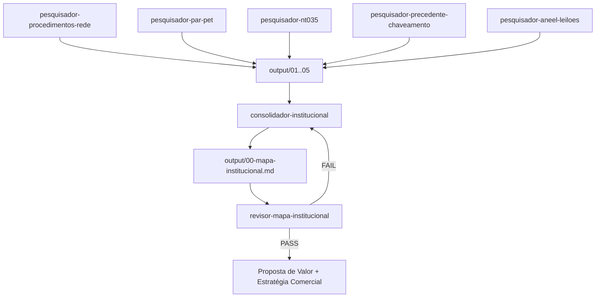
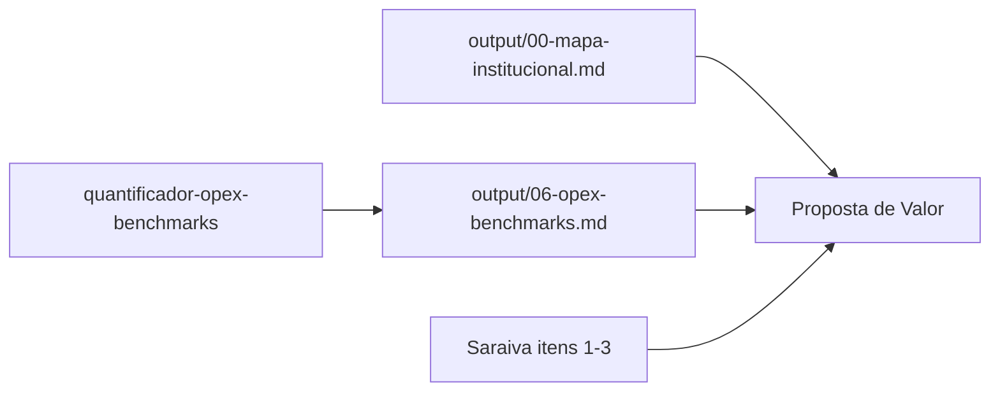

# Escopo e objetivo — Frente Comercial (Nasser)

## Projeto
Hackathon Hitachi Energy 2026. Plano de negócios para introduzir e consolidar
Variable Shunt Reactors (VSR / RDV) no Brasil e América Latina, produzidos na
planta de Guarulhos (SP) via Transferência de Tecnologia (ToT) de Ludvika, Suécia.

## Meu escopo (Nasser) — 5 entregáveis
1. Proposta de Valor          ← em construção (base institucional pronta)
2. Estratégia Comercial       ← em construção (base institucional pronta)
3. Análise de Concorrência    ← CONCLUÍDA
4. Barreiras e Riscos de Mercado
5. Projeção de Receita / ROI

Fora do meu escopo: Análise de Mercado técnica (Saraiva), Estratégia de
Implementação e CAPEX (Raphael).

## Objetivo da pesquisa institucional (este grupo de agentes)
Mapear ONDE e COMO a especificação técnica de equipamentos de compensação
reativa é escrita no setor elétrico brasileiro, para saber em que ponto da
cadeia o argumento do VSR precisa entrar. O resultado alimenta DOIS entregáveis:
Proposta de Valor e Estratégia Comercial.

Premissa fixada pelo case: a Hitachi JÁ decidiu internalizar a tecnologia. O
desafio não é convencer a Hitachi a fabricar — é criar demanda e influenciar
especificações conservadoras de ONS, EPE e transmissoras.

## Estado atual do pipeline institucional
As cinco pesquisas institucionais estão **concluídas**, o
`00-mapa-institucional.md` está consolidado e o `revisor-mapa-institucional`
aprovou a rodada 1 com **PASS 10/10 · FAIL 0/10**. O mapa é insumo válido para
os sintetizadores — não precisa ser reconsolidado.

O que segue aberto:
- `06-opex-benchmarks.md` ainda não foi produzido (ver "Agente fora do pipeline").
- Duas lacunas de prioridade ALTA continuam sem fonte primária — ver
  `output/links-anexos-tecnicos-para-download-manual.txt`.
- Proposta de Valor e Estratégia Comercial dependem também de insumos do
  Saraiva (itens 1-3) e do Raphael (item 5), fora do meu controle.

## Regras de diretório
- ESCRITA: exclusivamente dentro de `./` (a pasta Nasser). Nunca em `../Saraiva/`,
  `../Raphael/` ou na raiz.
- LEITURA: livre em todo o repositório, incluindo as pastas dos colegas.
- Todo output de agente vai em `./output/` como `.md`.
- Downloads automáticos feitos pelos agentes (PDFs baixados para extração) vão
  para diretório temporário do sistema, nunca para dentro de `./` — isso é
  responsabilidade do `./scripts/baixar_pdf.py`, não dos agentes.

### Fontes primárias baixadas manualmente — `./pdf/`
Documentos que nenhum agente conseguiu acessar sozinho (bloqueio de bot, link
de portlet com token de sessão, portal atrás de JS) e que eu baixei à mão ficam
em `./pdf/`. Essa pasta é **fonte primária de leitura, não cache descartável**.

Regras:
1. **Todo agente pesquisador verifica `./pdf/` ANTES de buscar na web.** Um
   documento que já está ali não precisa ser rebaixado nem procurado de novo.
2. **Nunca registre como lacuna algo que está em `./pdf/`.** Cheque a pasta
   antes de escrever a seção `## Lacunas de verificação`.
3. **O nome do arquivo não garante o conteúdo.** Já aconteceu de URLs rotuladas
   como "Anexo Técnico" entregarem outro documento (o Aviso de Consulta Pública
   e o Voto, no caso do Leilão 1/2026). Abra e confirme o que o documento é de
   fato antes de citá-lo — a citação descreve o conteúdo lido, não o rótulo da
   URL de origem.
4. Nenhum agente escreve, move ou apaga nada em `./pdf/`. Só leitura.

## Bash é restrito a um script único
Os seis agentes pesquisadores têm `Bash` nas tools, mas só para uma finalidade:
baixar um PDF e extrair o texto quando o WebFetch não dá conta. A única
invocação permitida é:

```
python3 ./scripts/baixar_pdf.py "<URL>"
```

O script (não o agente) garante as travas: só aceita URL http(s), nunca escreve
dentro do repositório, não interpola a URL num shell, tem teto de 80 MB e
timeout. Isso existe porque um `Bash` genérico nas mãos de um subagente pode
em tese rodar qualquer comando — `rm`, `mv` fora de `./`, etc. — mesmo que a
regra de diretório acima diga o contrário; a regra em texto não é uma trava do
sistema de arquivos.

`.claude/settings.json` reforça isso com um allowlist: a chamada ao script não
pede aprovação a cada vez, mas qualquer outro uso de `Bash` (`curl`, `wget`,
`rm`, `mv`, `git push`, `sudo`, `chmod`) é explicitamente negado antes mesmo de
chegar à aprovação manual. Não edite esse allowlist para liberar outros
comandos sem repensar o motivo pelo qual ele existe.

## Insumos internos já disponíveis
- Análise de Concorrência (entregável 3, concluída):
  `./analise_concorrencia/item3-analise-concorrentes.md`
- Detalhamento por fabricante: `./analise_concorrencia/concorrentes/`
- Consolidado intermediário: `./analise_concorrencia/item3-consolidado.md`

Leia antes de levantar qualquer coisa sobre fabricantes — não duplique.

## Pipeline dos agentes institucionais



**Fase 1 — pesquisa.** Os cinco pesquisadores são independentes entre si e
podem rodar em paralelo. Cada um escreve exatamente um arquivo:

| Agente | Output |
|---|---|
| pesquisador-procedimentos-rede | `output/01-procedimentos-rede.md` |
| pesquisador-par-pet | `output/02-par-pet.md` |
| pesquisador-nt035 | `output/03-nt035.md` |
| pesquisador-precedente-chaveamento | `output/04-precedente-chaveamento.md` |
| pesquisador-aneel-leiloes | `output/05-aneel-leiloes.md` |

**Fase 2 — consolidação.** `consolidador-institucional` só roda com os cinco
arquivos existindo. Produz `output/00-mapa-institucional.md`.

**Fase 3 — revisão e correção.** `revisor-mapa-institucional` produz
`output/00-revisao-mapa-institucional.md` com placar PASS/FAIL e uma linha de
ENCAMINHAMENTO. O loop:

1. Revisor aponta falhas → reinvocar o consolidador, que corrige **apenas** os
   itens apontados e preserva o resto.
2. Revisor roda de novo. Máximo de 3 rodadas.
3. Persistindo falha na rodada 3, o revisor escalona para mim — não há rodada 4.

O revisor nunca edita o mapa; o consolidador nunca se auto-aprova. Quem dispara
cada rodada sou eu (ou a sessão que estiver orquestrando), lendo a linha de
ENCAMINHAMENTO do relatório de revisão.

## Agente fora do pipeline institucional

`quantificador-opex-benchmarks` é um sexto pesquisador, com as mesmas regras de
rigor e o mesmo protocolo de PDF, mas **fora** da esteira dos cinco: ele não
alimenta o `consolidador-institucional` nem passa pelo revisor.



Escreve `output/06-opex-benchmarks.md`. É o único agente do projeto sem
dependência de insumo interno da equipe — pode rodar a qualquer momento,
independente do status de Saraiva e Raphael no tracker.

Ele lê, quando existirem: `output/04-precedente-chaveamento.md` (fonte CIGRÉ
compartilhada) e `./analise_concorrencia/` (para não duplicar fabricantes).

## Regras de rigor (valem para TODOS os agentes)
1. **Toda afirmação factual carrega fonte.** Nenhum número, data, valor ou
   afirmação sobre o setor pode aparecer sem referência rastreável.
2. **Formato de citação:** marcador `[n]` no texto + seção `## Fontes` ao final,
   numerada, com: título, órgão/veículo, URL, data de acesso e nível.
   Modelo: `1. [PRIMÁRIA] Título — órgão — URL — acesso em DD/MM/AAAA`
3. **Níveis de confiabilidade:**
   - `PRIMÁRIA` — documento do próprio órgão (ONS, EPE, ANEEL, CIGRÉ, Hitachi)
   - `IMPRENSA` — veículo jornalístico do setor
   - `RELATÓRIO` — consultoria/market report. Usar apenas para lista de players,
     nunca para números específicos. Marcar a limitação explicitamente.
   - `FABRICANTE` — material comercial ou caso de aplicação publicado por
     fabricante (Hitachi, MR, Siemens Energy, GE Vernova, TBEA). Fonte legítima
     para caso de referência e dado operacional, desde que o conflito de
     interesse seja registrado na própria linha. Nunca é fonte neutra de
     comparação entre fabricantes.
4. **Lacuna é resultado válido.** Se algo não foi encontrado, registrar em
   `## Lacunas de verificação` com o que foi tentado. Nunca preencher com estimativa.
5. **RDV ≠ reator fixo.** Toda menção a "reator" deve ser qualificada como fixo,
   manobrável (chaveável por disjuntor, reatância de valor único) ou variável
   (RDV/VSR, reatância continuamente ajustável). Ambiguidade é erro.
6. **STATCOM, SVC/CER, CARR e compensador síncrono não são concorrentes diretos
   do VSR.** Se aparecerem, tratar como alternativa de especificação concorrente
   na fase de planejamento — não como concorrente comercial de produto.
7. **PDF pesado não é lacuna.** As fontes primárias deste projeto (submódulos do
   ONS, relatório completo do PAR/PEL, PET/PELP, NT-035, editais ANEEL e seus
   anexos R1–R5) são PDFs longos que o WebFetch trunca ou recusa. Antes de
   registrar lacuna: (a) verifique `./pdf/`; (b) rode
   `python3 ./scripts/baixar_pdf.py "<URL>"` e busque por termo no `.txt`
   extraído. Só é lacuna o que resistiu também a essas duas vias — e o registro
   deve dizer qual via foi tentada.

## Glossário
RDV/VSR (reator de derivação variável), OLTC/CDC (comutador de derivação em carga),
SIN (Sistema Interligado Nacional), ONS (operador), EPE (planejador),
ANEEL (regulador/leilões), MME (consolida PAR+PET no POTEE),
PAR/PEL (ONS), PET/PELP (EPE), POTEE (MME), CARR (Controle Automático Rápido de
Reativos), CER (compensador estático de reativos), Rede Básica, EAT (extra-alta
tensão), deságio, conteúdo local, ToT, FACTS.
